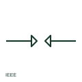

# ANSI/IEEE spark gap symbol

IEEE-oriented spark gap drawn as two facing electrodes separated by an air gap, which breaks down at high voltage.

[Canonical reference](https://eloragrid.ai/symbols/ansi-spark-gap) · [Structured record](../entries/ansi-spark-gap.json) · [All references](README.md)

Updated: 2026-10-28. Drawing use: Schematic. Reference families: IEEE / ANSI, Manufacturer.

Graphical convention: IEEE / ANSI. Autodesk IEEE-oriented spark gap form.

## What it represents

A spark gap is a pair of electrodes separated by a gap that flashes over when the voltage exceeds its breakdown level. It appears in surge protection of telecom and control circuits and on older equipment as coordinating gaps. The publisher's IEEE miscellaneous preview lists a spark gap form, the counterpart of the existing IEC page.
This illustration is independent and not the IEEE graphic. A plain spark gap can sustain follow current after breakdown on power circuits, which is why power arresters use other technology. The breakdown voltage depends on gap spacing and conditions, and must be specified.

## How to read it

- Check whether follow current could be sustained on the circuit.
- Read breakdown voltage from equipment data.

## Drawing checklist

- State breakdown voltage.
- Show the protected and earthed sides.
- Use an arrester where follow current is a risk.

## Important distinction

A spark gap is a simple breakdown element; a gas discharge tube encloses the gap in gas for a defined breakdown.

## Facts

- Convention evidence: Autodesk IEEE Symbol Preview: Miscellaneous (Spark Gap)
- Public vendor block name: HFU1\_S00371 (Autodesk identifier; not an IEEE symbol number)
- Standards context: IEEE/ANSI 315-1975 covers diagram graphics; IEEE lists this edition as Inactive-Reserved.
- Preview: Original educational illustration; consult the publisher and applicable standard for the exact graphic

## Public references

- [Autodesk IEEE Symbol Preview — Miscellaneous](https://help.autodesk.com/cloudhelp/2021/ENU/AutoCAD-Electrical/files/GUID-34282BFD-7B8E-48F3-A6ED-93ADBDDDFBD3.htm) — Autodesk. Exact public IEEE-oriented category page listing the spark gap form.
- [IEEE/ANSI 315-1975: graphic symbols for electrical and electronics diagrams](https://standards.ieee.org/ieee/315/515/) — IEEE Standards Association. Graphic-symbol standards context and official status; not a source of reproduced artwork.

## Related references

- [Spark-gap protective element](spark-gap-protective-element.md)
- [ANSI/IEEE gas discharge tube symbol](ansi-gas-discharge-tube.md)
- [ANSI/IEEE surge arrester symbol](ansi-surge-arrester.md)

Original educational concept geometry, CC BY 4.0. Unitless; not a certified standards glyph or manufacturer footprint.

Elora-authored explanations are CC BY 4.0. Linked standards and manufacturer material retain their own rights. Confirm project requirements using primary sources.
