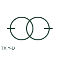

# ANSI/IEEE Star-delta transformer form

IEEE-library form of star-delta transformer: a star-delta transformer connects one winding set in star and the other in delta.

[Canonical reference](https://eloragrid.ai/symbols/ansi-star-delta-transformer) · [Structured record](../entries/ansi-star-delta-transformer.json) · [All references](README.md)

Updated: 2026-10-28. Drawing use: SLD, Schematic. Reference families: IEEE / ANSI, Manufacturer.

Graphical convention: IEEE / ANSI. 3 Phase Star/Delta.

## What it represents

This reference locates star-delta transformer in Autodesk's IEEE-oriented 3 phase transformers family. A star-delta transformer connects one winding set in star and the other in delta. The notation identifies winding topology; a clock-number or equivalent phase-displacement designation is still needed where system phase relationships matter. The public library uses HXF1P3SD for its horizontal representation; this is a vendor block name, not an IEEE standards symbol number.
Trace each winding, supply and accessible neutral through the complete machine or transformer connection diagram. Keep the phase arrangement, terminal labels and any clock notation attached to the device; neither the convention label nor this educational outline supplies its ratings.
Read which side is star from the declared primary and secondary labels. Y-D topology alone does not specify a complete transformer vector group. The linked functional counterpart explains the same operating role in its own drawing context; agreement of every detailed convention mark is not asserted.

## How to read it

- Read which side is star from the declared primary and secondary labels.
- The preview is an original explanation of this function. Match the actual drawing convention to its legend and the selected equipment documentation.

## Drawing checklist

- Identify winding sides
- State complete vector group
- Show neutral availability

## Important distinction

Y-D topology alone does not specify a complete transformer vector group.

## Facts

- Convention evidence: Autodesk IEEE Symbol Preview: 3 Phase Transformers; published form: 3 Phase Star/Delta.
- Public vendor block: HXF1P3SD. Vendor library token, not an IEEE symbol number.
- Drawing role: Winding connection
- Identifier status: The short label is a functional lookup label, not an assigned IEC or IEEE symbol number. Any separately listed Autodesk code is a verified vendor block name.
- Artwork scope: Original educational geometry. Exact standard graphics, product ratings and terminal pinouts are not certified.

## Public references

- [Autodesk IEEE Symbol Preview: 3 Phase Transformers](https://help.autodesk.com/cloudhelp/2021/ENU/AutoCAD-Electrical/files/GUID-EE75A5D4-8CBD-4E78-94A3-226A94E61817.htm) — Autodesk. Public IEEE-oriented 3 Phase Transformers table explicitly lists HXF1P3SD as 3 Phase Star/Delta. This supports the vendor convention context, not reproduction of the publisher graphic.

## Related references

- [Star-delta transformer](star-delta-transformer.md)
- [Power transformer](power-transformer.md)
- [Voltage transformer](voltage-transformer.md)

Original educational concept geometry, CC BY 4.0. Unitless; not a certified standards glyph or manufacturer footprint.

Elora-authored explanations are CC BY 4.0. Linked standards and manufacturer material retain their own rights. Confirm project requirements using primary sources.
