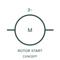

# ANSI/IEEE Star-stator wound-rotor motor with rotor starter form

IEEE-library reference for star-stator wound-rotor motor with rotor starter, with its operating meaning, connection notes and public vendor block identity.

[Canonical reference](https://eloragrid.ai/symbols/ansi-star-stator-wound-rotor-motor-with-rotor-starter) · [Structured record](../entries/ansi-star-stator-wound-rotor-motor-with-rotor-starter.json) · [All references](README.md)

Updated: 2026-10-28. Drawing use: SLD, Schematic. Reference families: IEEE / ANSI, Manufacturer.

Graphical convention: IEEE / ANSI. 3 Phase Asynchro Star Connected Stator Auto Starter on Rotor.

## What it represents

This reference locates star-stator wound-rotor motor with rotor starter in Autodesk's IEEE-oriented 3 phase motors family. This representation distinguishes star-connected stator and a starter arrangement associated with the rotor circuit. The public library uses HMO1M5 for its horizontal representation; this is a vendor block name, not an IEEE standards symbol number.
Trace each winding, supply and accessible neutral through the complete machine or transformer connection diagram. Keep the phase arrangement, terminal labels and any clock notation attached to the device; neither the convention label nor this educational outline supplies its ratings.
Show stator supply, rotor connections and the selected starting equipment. Rotor-circuit starting and stator voltage starting are different circuit arrangements. Show stator supply, rotor connections and the selected starting equipment. Rotor-circuit starting and stator voltage starting are different circuit arrangements. The linked functional counterpart explains the same operating role in its own drawing context; agreement of every detailed convention mark is not asserted.

## How to read it

- Show stator supply, rotor connections and the selected starting equipment.
- Rotor-circuit starting and stator voltage starting are different circuit arrangements.

## Drawing checklist

- Identify the associated device, circuit or diagram boundary.
- Show stator supply, rotor connections and the selected starting equipment.
- Cross-reference the equipment data, terminal mapping or operating-state legend needed to interpret the form.

## Important distinction

Rotor-circuit starting and stator voltage starting are different circuit arrangements.

## Facts

- Convention evidence: Autodesk IEEE Symbol Preview: 3 Phase Motors; published form: 3 Phase Asynchro Star Connected Stator Auto Starter on Rotor.
- Public vendor block: HMO1M5. Vendor library token, not an IEEE symbol number.
- Information added: Show stator supply, rotor connections and the selected starting equipment.
- Preview: Independent educational concept; consult the publisher and applicable standard for the exact graphic
- Artwork scope: Original educational geometry. Exact standard graphics, product ratings and terminal pinouts are not certified.

## Public references

- [Autodesk IEEE Symbol Preview — 3 Phase Motors](https://help.autodesk.com/cloudhelp/2021/ENU/AutoCAD-Electrical/files/GUID-392101FD-A88C-4BAC-96CD-1C676094C262.htm) — Autodesk. Public IEEE-oriented 3 Phase Motors table explicitly lists HMO1M5 as 3 Phase Asynchro Star Connected Stator Auto Starter on Rotor. This supports the vendor convention context, not reproduction of the publisher graphic.

## Related references

- [Star-stator wound-rotor motor with rotor starter](iec-star-stator-wound-rotor-motor-with-rotor-starter.md)
- [Three-phase motor](motor.md)
- [Generator](generator.md)

Original educational concept geometry, CC BY 4.0. Unitless; not a certified standards glyph or manufacturer footprint.

Elora-authored explanations are CC BY 4.0. Linked standards and manufacturer material retain their own rights. Confirm project requirements using primary sources.
