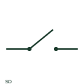

# ANSI/IEEE switch-disconnector symbol

IEEE-oriented graphical reference for switch-disconnector, with public vendor evidence and drawing-reading notes.

[Canonical reference](https://eloragrid.ai/symbols/ansi-switch-disconnector) · [Structured record](../entries/ansi-switch-disconnector.json) · [All references](README.md)

Updated: 2026-10-27. Drawing use: SLD, Schematic. Reference families: IEEE / ANSI, Manufacturer.

Graphical convention: IEEE / ANSI. Autodesk IEEE-oriented Disconnect 1 Pole functional form.

## What it represents

A switch-disconnector representation identifies operational switching combined with a documented isolation function. The distinction matters when selecting a library element for a feeder that must both switch its assigned load and provide isolation.
This is a convention-specific lookup based on the publisher's IEEE-labelled preview. The geometry here is independently drawn to explain the connection or operation; it is not a certified reproduction of the standard graphic.

## How to read it

- The equipment label must confirm both functions.
- Read the selected library and the project legend together. A vendor block identifier is meaningful within its named library and is not a universal standard-symbol code.

## Drawing checklist

- State utilization duty
- Identify isolation designation
- Show connected poles

## Important distinction

A disconnector and a switch-disconnector can share a family of contact graphics without sharing the same switching duty.

## Facts

- Convention evidence: Autodesk IEEE Symbol Preview — Disconnect 1 Pole
- Public vendor block name: HDS11Q69 (Autodesk identifier; not an IEEE symbol number)
- Standards context: IEEE/ANSI 315-1975 covers diagram graphics. IEEE lists this edition as Inactive-Reserved.
- Artwork scope: Original functional illustration; exact standard glyph and compliance are not certified

## Public references

- [Autodesk IEEE Symbol Preview — Disconnect 1 Pole](https://help.autodesk.com/cloudhelp/2021/ENU/AutoCAD-Electrical/files/GUID-7C62D3DE-6494-4CBF-B3CF-3E3DA309D6A4.htm) — Autodesk. Exact public IEEE-oriented category page verifying the component name and vendor block identifier.
- [IEEE/ANSI 315-1975: graphic symbols for electrical and electronics diagrams](https://standards.ieee.org/ieee/315/515/) — IEEE Standards Association. Graphic-symbol standards context and official status; not a source of reproduced artwork.

## Related references

- [Switch-disconnector](switch-disconnector.md)
- [Disconnector](disconnector.md)
- [Circuit breaker](circuit-breaker.md)

Original educational concept geometry, CC BY 4.0. Unitless; not a certified standards glyph or manufacturer footprint.

Elora-authored explanations are CC BY 4.0. Linked standards and manufacturer material retain their own rights. Confirm project requirements using primary sources.
