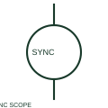

# ANSI/IEEE synchronoscope symbol

IEEE-oriented graphical reference for synchronoscope, with public vendor evidence and drawing-reading notes.

[Canonical reference](https://eloragrid.ai/symbols/ansi-synchronoscope) · [Structured record](../entries/ansi-synchronoscope.json) · [All references](README.md)

Updated: 2026-10-27. Drawing use: SLD, Schematic. Reference families: IEEE / ANSI, Manufacturer.

Graphical convention: IEEE / ANSI. Autodesk IEEE-oriented Instrumentation and Sensors functional form.

## What it represents

The synchronoscope form identifies an instrument comparing two AC sources. The incoming and reference inputs determine the meaning of its phase and relative-frequency indication; a separate permissive function is shown where the design includes one.
This is a convention-specific lookup based on the publisher's IEEE-labelled preview. The geometry here is independently drawn to explain the connection or operation; it is not a certified reproduction of the standard graphic.

## How to read it

- Follow both source inputs and their phase selections.
- Read the selected library and the project legend together. A vendor block identifier is meaningful within its named library and is not a universal standard-symbol code.

## Drawing checklist

- Name incoming/reference sources
- Show input selection
- Reference indication convention

## Important distinction

A synchronoscope supplies indication, whereas a synchronism-check relay supplies a configured permissive output.

## Facts

- Convention evidence: Autodesk IEEE Symbol Preview — Instrumentation and Sensors
- Public vendor block name: HIN1P11 (Autodesk identifier; not an IEEE symbol number)
- Standards context: IEEE/ANSI 315-1975 covers diagram graphics. IEEE lists this edition as Inactive-Reserved.
- Artwork scope: Original functional illustration; exact standard glyph and compliance are not certified

## Public references

- [Autodesk IEEE Symbol Preview — Instrumentation and Sensors](https://help.autodesk.com/cloudhelp/2021/ENU/AutoCAD-Electrical/files/GUID-F44D5059-4728-40BD-B9BA-0DE7CFDFAACF.htm) — Autodesk. Exact public IEEE-oriented category page verifying the component name and vendor block identifier.
- [IEEE/ANSI 315-1975: graphic symbols for electrical and electronics diagrams](https://standards.ieee.org/ieee/315/515/) — IEEE Standards Association. Graphic-symbol standards context and official status; not a source of reproduced artwork.

## Related references

- [Synchronoscope](synchronoscope.md)
- [Current transformer](current-transformer.md)
- [Voltage transformer](voltage-transformer.md)

Original educational concept geometry, CC BY 4.0. Unitless; not a certified standards glyph or manufacturer footprint.

Elora-authored explanations are CC BY 4.0. Linked standards and manufacturer material retain their own rights. Confirm project requirements using primary sources.
