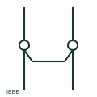

# ANSI/IEEE terminal jumper symbol

IEEE-oriented jumper drawn between adjacent terminals to show they are strapped together.

[Canonical reference](https://eloragrid.ai/symbols/ansi-terminal-jumper) · [Structured record](../entries/ansi-terminal-jumper.json) · [All references](README.md)

Updated: 2026-10-28. Drawing use: Schematic. Reference families: IEEE / ANSI.

Graphical convention: IEEE / ANSI. Terminal jumper form.

## What it represents

US-practice schematics show jumpers between terminals as a short line or curved strap linking terminal circles, often with a JMP designation. It is common on relay panel terminal strips where common supplies or returns are distributed across several terminals.
This illustration is an independent explanation rather than the IEEE graphic. A jumper can be a plug-in bridge, a wire link or a screwed strap, and the symbol does not distinguish them. Jumpers that must be removed for testing should be identified as such.

## How to read it

- Check whether the jumper is removed during testing.
- Identify the physical jumper type.

## Drawing checklist

- Show every jumper on the terminal plan.
- Mark test-removable jumpers.
- Keep the jumper current within terminal rating.

## Important distinction

A terminal jumper ties adjacent terminals; a wire splice joins conductors without terminals.

## Facts

- Convention evidence: Autodesk IEEE Symbol Preview: Terminals family context
- Standards context: IEEE/ANSI 315-1975 covers diagram graphics; IEEE lists this edition as Inactive-Reserved.
- Preview: Original educational illustration; consult the publisher and applicable standard for the exact graphic

## Public references

- [Autodesk IEEE Symbol Preview — Terminals](https://help.autodesk.com/cloudhelp/2021/ENU/AutoCAD-Electrical/files/GUID-7C566B17-0C91-47F1-AD86-73893490622C.htm) — Autodesk. Public IEEE-oriented terminal preview family.
- [IEEE/ANSI 315-1975: graphic symbols for electrical and electronics diagrams](https://standards.ieee.org/ieee/315/515/) — IEEE Standards Association. Graphic-symbol standards context and official status; not a source of reproduced artwork.

## Related references

- [Terminal jumper bridge](terminal-jumper-bridge.md)
- [ANSI/IEEE terminal connection symbol](ansi-terminal.md)
- [ANSI/IEEE numbered terminal symbol](ansi-numbered-terminal.md)

Original educational concept geometry, CC BY 4.0. Unitless; not a certified standards glyph or manufacturer footprint.

Elora-authored explanations are CC BY 4.0. Linked standards and manufacturer material retain their own rights. Confirm project requirements using primary sources.
