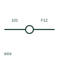

# ANSI/IEEE terminal with wire number change symbol

IEEE-oriented round terminal at which the wire number changes, with a different number on each side.

[Canonical reference](https://eloragrid.ai/symbols/ansi-terminal-with-wire-number-change) · [Structured record](../entries/ansi-terminal-with-wire-number-change.json) · [All references](README.md)

Updated: 2026-10-28. Drawing use: Schematic. Reference families: IEEE / ANSI, Manufacturer.

Graphical convention: IEEE / ANSI. Autodesk IEEE-oriented Round with Wire Number Change terminal.

## What it represents

The publisher's IEEE terminal preview includes a round terminal form at which the wire number changes. It is used at boundaries such as panel to field interfaces, where the panel wiring uses one numbering scheme and the field cable cores another.
This illustration is independent and not the IEEE graphic. The electrical connection is continuous; only the identifier changes. Readers tracing a circuit must follow the number change, and the terminal plan should list both numbers against the terminal.

## How to read it

- Follow the new wire number beyond the terminal.
- Check both numbers appear on the terminal plan.

## Drawing checklist

- Show both wire numbers at the terminal.
- List both on the terminal plan.
- Use the change form only at genuine boundaries.

## Important distinction

The change form renumbers the wire; the standard wire number form keeps one number through the terminal.

## Facts

- Convention evidence: Autodesk IEEE Symbol Preview: Terminals (Round with Wire Number Change)
- Public vendor block name: HT1002 (Autodesk identifier; not an IEEE symbol number)
- Standards context: IEEE/ANSI 315-1975 covers diagram graphics; IEEE lists this edition as Inactive-Reserved.
- Preview: Original educational illustration; consult the publisher and applicable standard for the exact graphic

## Public references

- [Autodesk IEEE Symbol Preview — Terminals](https://help.autodesk.com/cloudhelp/2021/ENU/AutoCAD-Electrical/files/GUID-7C566B17-0C91-47F1-AD86-73893490622C.htm) — Autodesk. Exact public IEEE-oriented terminal preview listing the round with wire number change form.
- [IEEE/ANSI 315-1975: graphic symbols for electrical and electronics diagrams](https://standards.ieee.org/ieee/315/515/) — IEEE Standards Association. Graphic-symbol standards context and official status; not a source of reproduced artwork.

## Related references

- [Terminal with wire-number transition](iec-terminal-with-wire-number-transition.md)
- [ANSI/IEEE terminal with wire number symbol](ansi-terminal-with-wire-number.md)
- [ANSI/IEEE numbered terminal symbol](ansi-numbered-terminal.md)

Original educational concept geometry, CC BY 4.0. Unitless; not a certified standards glyph or manufacturer footprint.

Elora-authored explanations are CC BY 4.0. Linked standards and manufacturer material retain their own rights. Confirm project requirements using primary sources.
