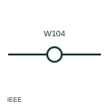

# ANSI/IEEE terminal with wire number symbol

IEEE-oriented round terminal that displays the wire number passing through it rather than a terminal number.

[Canonical reference](https://eloragrid.ai/symbols/ansi-terminal-with-wire-number) · [Structured record](../entries/ansi-terminal-with-wire-number.json) · [All references](README.md)

Updated: 2026-10-28. Drawing use: Schematic. Reference families: IEEE / ANSI, Manufacturer.

Graphical convention: IEEE / ANSI. Autodesk IEEE-oriented Round with Wire Number terminal.

## What it represents

The publisher's IEEE terminal preview lists a round terminal form that shows the wire number at the terminal. It is used where the wire identity is more useful to the reader than the terminal position, for example on field wiring sheets where technicians trace wires by number.
This illustration is independent and not the IEEE graphic. The form does not show the terminal strip position, so the terminal plan is still needed to find the physical terminal. The wire number continues unchanged through the terminal in this form.

## How to read it

- Use the terminal plan to locate the physical position.
- Read the wire number as continuous through the terminal.

## Drawing checklist

- Keep wire numbers unique.
- Link to the terminal plan.
- Use the change form where the number changes.

## Important distinction

This form shows the wire number; the ANSI numbered terminal form shows the terminal number.

## Facts

- Convention evidence: Autodesk IEEE Symbol Preview: Terminals (Round with Wire Number)
- Public vendor block name: HT0W02 (Autodesk identifier; not an IEEE symbol number)
- Standards context: IEEE/ANSI 315-1975 covers diagram graphics; IEEE lists this edition as Inactive-Reserved.
- Preview: Original educational illustration; consult the publisher and applicable standard for the exact graphic

## Public references

- [Autodesk IEEE Symbol Preview — Terminals](https://help.autodesk.com/cloudhelp/2021/ENU/AutoCAD-Electrical/files/GUID-7C566B17-0C91-47F1-AD86-73893490622C.htm) — Autodesk. Exact public IEEE-oriented terminal preview listing the round with wire number form.
- [IEEE/ANSI 315-1975: graphic symbols for electrical and electronics diagrams](https://standards.ieee.org/ieee/315/515/) — IEEE Standards Association. Graphic-symbol standards context and official status; not a source of reproduced artwork.

## Related references

- [Terminal carrying wire identification](iec-terminal-carrying-wire-identification.md)
- [ANSI/IEEE numbered terminal symbol](ansi-numbered-terminal.md)
- [ANSI/IEEE terminal with wire number change symbol](ansi-terminal-with-wire-number-change.md)

Original educational concept geometry, CC BY 4.0. Unitless; not a certified standards glyph or manufacturer footprint.

Elora-authored explanations are CC BY 4.0. Linked standards and manufacturer material retain their own rights. Confirm project requirements using primary sources.
