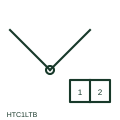

# ANSI/IEEE thermocouple with terminal board symbol

IEEE-library thermocouple form that adds the head terminal board where element leads change to field cable.

[Canonical reference](https://eloragrid.ai/symbols/ansi-thermocouple-with-terminal-board) · [Structured record](../entries/ansi-thermocouple-with-terminal-board.json) · [All references](README.md)

Updated: 2026-10-28. Drawing use: Schematic. Reference families: IEEE / ANSI, Manufacturer.

Graphical convention: IEEE / ANSI. Autodesk IEEE-oriented Instrumentation and Sensors form: Thermocouple with Terminal Board.

## What it represents

This form adds the terminal board in the thermocouple head to the basic junction symbol. It is useful on loop and wiring diagrams because the terminal board marks the boundary between the element, which is replaced with the sensor, and the field extension cable, which stays in place.
Drawing the terminal board makes polarity at the changeover explicit, but it still does not tell you the thermocouple type or whether the head contains a transmitter. If a head-mounted transmitter is fitted, the output becomes a current loop and should be drawn as such.

## How to read it

- Use the terminal numbers to check polarity at the head.
- Confirm whether a head transmitter replaces the direct millivolt connection.

## Drawing checklist

- Number the head terminals
- Show extension cable type
- Note any head-mounted transmitter

## Important distinction

The terminal-board form shows the head connection point; the plain thermocouple form shows only the junction and leads.

## Facts

- Convention evidence: Autodesk IEEE Symbol Preview, Instrumentation and Sensors
- Public vendor block name: HTC1LTB / HTC1RTB and vertical forms (Autodesk identifier; not an IEEE symbol number)
- Boundary shown: Sensor element to field cable changeover
- Artwork scope: Original functional illustration; exact standard glyph and compliance are not certified

## Public references

- [Autodesk IEEE Symbol Preview — Instrumentation and Sensors](https://help.autodesk.com/cloudhelp/2021/ENU/AutoCAD-Electrical/files/GUID-F44D5059-4728-40BD-B9BA-0DE7CFDFAACF.htm) — Autodesk. Public IEEE-oriented Instrumentation and Sensors preview listing the Thermocouple with Terminal Board block and its vendor identifier.
- [IEEE/ANSI 315-1975: graphic symbols for electrical and electronics diagrams](https://standards.ieee.org/ieee/315/515/) — IEEE Standards Association. Graphic-symbol standards context and official status; not a source of reproduced artwork.

## Related references

- [Thermocouple with terminal board](iec-thermocouple-with-terminal-board.md)
- [ANSI/IEEE thermocouple symbol](ansi-thermocouple.md)
- [Sensor terminal block](sensor-terminal-block.md)

Original educational concept geometry, CC BY 4.0. Unitless; not a certified standards glyph or manufacturer footprint.

Elora-authored explanations are CC BY 4.0. Linked standards and manufacturer material retain their own rights. Confirm project requirements using primary sources.
