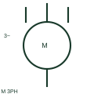

# ANSI/IEEE three-phase ac motor symbol

IEEE-oriented graphical reference for three-phase ac motor, with public vendor evidence and drawing-reading notes.

[Canonical reference](https://eloragrid.ai/symbols/ansi-three-phase-ac-motor) · [Structured record](../entries/ansi-three-phase-ac-motor.json) · [All references](README.md)

Updated: 2026-10-27. Drawing use: SLD, Schematic. Reference families: IEEE / ANSI, Manufacturer.

Graphical convention: IEEE / ANSI. Autodesk IEEE-oriented 3 Phase Motors functional form.

## What it represents

The three-phase motor form identifies a load connected to a documented three-phase circuit. Star/delta links, starter and overload information are separate details that should be linked rather than inferred from the machine representation.
This is a convention-specific lookup based on the publisher's IEEE-labelled preview. The geometry here is independently drawn to explain the connection or operation; it is not a certified reproduction of the standard graphic.

## How to read it

- Distinguish simplified load indication from an expanded winding connection.
- Read the selected library and the project legend together. A vendor block identifier is meaningful within its named library and is not a universal standard-symbol code.

## Drawing checklist

- State motor rating
- Reference winding links
- Show starter/overload arrangement

## Important distinction

Three-phase representation does not by itself establish a star or delta connection.

## Facts

- Convention evidence: Autodesk IEEE Symbol Preview — 3 Phase Motors
- Public vendor block name: HMO13 (Autodesk identifier; not an IEEE symbol number)
- Standards context: IEEE/ANSI 315-1975 covers diagram graphics. IEEE lists this edition as Inactive-Reserved.
- Artwork scope: Original functional illustration; exact standard glyph and compliance are not certified

## Public references

- [Autodesk IEEE Symbol Preview — 3 Phase Motors](https://help.autodesk.com/cloudhelp/2021/ENU/AutoCAD-Electrical/files/GUID-392101FD-A88C-4BAC-96CD-1C676094C262.htm) — Autodesk. Exact public IEEE-oriented category page verifying the component name and vendor block identifier.
- [IEEE/ANSI 315-1975: graphic symbols for electrical and electronics diagrams](https://standards.ieee.org/ieee/315/515/) — IEEE Standards Association. Graphic-symbol standards context and official status; not a source of reproduced artwork.

## Related references

- [Three-phase AC motor](three-phase-ac-motor.md)
- [Three-phase motor](motor.md)
- [Contactor](contactor.md)

Original educational concept geometry, CC BY 4.0. Unitless; not a certified standards glyph or manufacturer footprint.

Elora-authored explanations are CC BY 4.0. Linked standards and manufacturer material retain their own rights. Confirm project requirements using primary sources.
