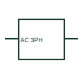

# ANSI/IEEE Three-phase AC source form

IEEE-library form of three-phase ac source: a three-phase AC source identifies a documented three-phase supply boundary.

[Canonical reference](https://eloragrid.ai/symbols/ansi-three-phase-ac-source) · [Structured record](../entries/ansi-three-phase-ac-source.json) · [All references](README.md)

Updated: 2026-10-28. Drawing use: SLD, Schematic. Reference families: IEEE / ANSI, Manufacturer.

Graphical convention: IEEE / ANSI. Power Source 3 Phase.

## What it represents

This reference locates three-phase ac source in Autodesk's IEEE-oriented miscellaneous family. A three-phase AC source identifies a documented three-phase supply boundary. Its nominal voltage, phase sequence and neutral availability must be stated where the design relies on them. The public library uses HPW1\_3PH for its horizontal representation; this is a vendor block name, not an IEEE standards symbol number.
Use the surrounding circuit labels and the project legend to identify the intended operating condition and connection. Carry the same device reference into the schedule or equipment document so the symbol can be reconciled with its real terminals, function and operating limits.
Locate the source boundary before interpreting upstream ownership or available fault data. Three-phase source designation does not establish an accessible neutral conductor. The linked functional counterpart explains the same operating role in its own drawing context; agreement of every detailed convention mark is not asserted.

## How to read it

- Locate the source boundary before interpreting upstream ownership or available fault data.
- The preview is an original explanation of this function. Match the actual drawing convention to its legend and the selected equipment documentation.

## Drawing checklist

- Name supply origin
- State voltage and phase sequence
- Reference neutral/earthing arrangement

## Important distinction

Three-phase source designation does not establish an accessible neutral conductor.

## Facts

- Convention evidence: Autodesk IEEE Symbol Preview: Miscellaneous; published form: Power Source 3 Phase.
- Public vendor block: HPW1\_3PH. Vendor library token, not an IEEE symbol number.
- Drawing role: Supply or network role
- Identifier status: The short label is a functional lookup label, not an assigned IEC or IEEE symbol number. Any separately listed Autodesk code is a verified vendor block name.
- Artwork scope: Original educational geometry. Exact standard graphics, product ratings and terminal pinouts are not certified.

## Public references

- [Autodesk IEEE Symbol Preview — Miscellaneous](https://help.autodesk.com/cloudhelp/2021/ENU/AutoCAD-Electrical/files/GUID-34282BFD-7B8E-48F3-A6ED-93ADBDDDFBD3.htm) — Autodesk. Public IEEE-oriented Miscellaneous table explicitly lists HPW1\_3PH as Power Source 3 Phase. This supports the vendor convention context, not reproduction of the publisher graphic.

## Related references

- [Three-phase AC source](three-phase-ac-source.md)
- [Generator](generator.md)
- [Busbar](busbar.md)

Original educational concept geometry, CC BY 4.0. Unitless; not a certified standards glyph or manufacturer footprint.

Elora-authored explanations are CC BY 4.0. Linked standards and manufacturer material retain their own rights. Confirm project requirements using primary sources.
