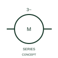

# ANSI/IEEE Three-phase induction motor with series excitation form

IEEE-library form of three-phase induction motor with series excitation: this representation identifies the publisher's asynchronous motor form with series excitation.

[Canonical reference](https://eloragrid.ai/symbols/ansi-three-phase-induction-motor-with-series-excitation) · [Structured record](../entries/ansi-three-phase-induction-motor-with-series-excitation.json) · [All references](README.md)

Updated: 2026-10-28. Drawing use: SLD, Schematic. Reference families: IEEE / ANSI, Manufacturer.

Graphical convention: IEEE / ANSI. 3 Phase Asynchro Motor with Series Excitation.

## What it represents

This reference locates three-phase induction motor with series excitation in Autodesk's IEEE-oriented 3 phase motors family. This representation identifies the publisher's asynchronous motor form with series excitation. The public library uses HMO1M3 for its horizontal representation; this is a vendor block name, not an IEEE standards symbol number.
Trace each winding, supply and accessible neutral through the complete machine or transformer connection diagram. Keep the phase arrangement, terminal labels and any clock notation attached to the device; neither the convention label nor this educational outline supplies its ratings.
Document stator, excitation and any associated control connections separately. The reference form does not identify a conventional squirrel-cage motor without an excitation circuit. Document stator, excitation and any associated control connections separately. The reference form does not identify a conventional squirrel-cage motor without an excitation circuit. The linked functional counterpart explains the same operating role in its own drawing context; agreement of every detailed convention mark is not asserted.

## How to read it

- Document stator, excitation and any associated control connections separately.
- The reference form does not identify a conventional squirrel-cage motor without an excitation circuit.

## Drawing checklist

- Identify the associated device, circuit or diagram boundary.
- Document stator, excitation and any associated control connections separately.
- Cross-reference the equipment data, terminal mapping or operating-state legend needed to interpret the form.

## Important distinction

The reference form does not identify a conventional squirrel-cage motor without an excitation circuit.

## Facts

- Convention evidence: Autodesk IEEE Symbol Preview: 3 Phase Motors; published form: 3 Phase Asynchro Motor with Series Excitation.
- Public vendor block: HMO1M3. Vendor library token, not an IEEE symbol number.
- Information added: Document stator, excitation and any associated control connections separately.
- Preview: Independent educational concept; consult the publisher and applicable standard for the exact graphic
- Artwork scope: Original educational geometry. Exact standard graphics, product ratings and terminal pinouts are not certified.

## Public references

- [Autodesk IEEE Symbol Preview — 3 Phase Motors](https://help.autodesk.com/cloudhelp/2021/ENU/AutoCAD-Electrical/files/GUID-392101FD-A88C-4BAC-96CD-1C676094C262.htm) — Autodesk. Public IEEE-oriented 3 Phase Motors table explicitly lists HMO1M3 as 3 Phase Asynchro Motor with Series Excitation. This supports the vendor convention context, not reproduction of the publisher graphic.

## Related references

- [Three-phase induction motor with series excitation](iec-three-phase-induction-motor-with-series-excitation.md)
- [Three-phase motor](motor.md)
- [Generator](generator.md)

Original educational concept geometry, CC BY 4.0. Unitless; not a certified standards glyph or manufacturer footprint.

Elora-authored explanations are CC BY 4.0. Linked standards and manufacturer material retain their own rights. Confirm project requirements using primary sources.
