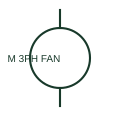

# ANSI/IEEE Three-phase motor with fan form

IEEE-library form of three-phase motor with fan: a three-phase motor with fan identifies an electrically driven ventilation or cooling load.

[Canonical reference](https://eloragrid.ai/symbols/ansi-three-phase-motor-with-fan) · [Structured record](../entries/ansi-three-phase-motor-with-fan.json) · [All references](README.md)

Updated: 2026-10-28. Drawing use: SLD, Schematic. Reference families: IEEE / ANSI, Manufacturer.

Graphical convention: IEEE / ANSI. 3 Phase Motor with Fan.

## What it represents

This reference locates three-phase motor with fan in Autodesk's IEEE-oriented 3 phase motors family. A three-phase motor with fan identifies an electrically driven ventilation or cooling load. The motor supply and the mechanical airflow arrangement are documented through linked tags. The public library uses HMO1M2 for its horizontal representation; this is a vendor block name, not an IEEE standards symbol number.
Trace each winding, supply and accessible neutral through the complete machine or transformer connection diagram. Keep the phase arrangement, terminal labels and any clock notation attached to the device; neither the convention label nor this educational outline supplies its ratings.
Identify whether the fan is an independent auxiliary load or associated with another machine. The fan symbol describes driven equipment while the motor symbol describes its electrical load. The linked functional counterpart explains the same operating role in its own drawing context; agreement of every detailed convention mark is not asserted.

## How to read it

- Identify whether the fan is an independent auxiliary load or associated with another machine.
- The preview is an original explanation of this function. Match the actual drawing convention to its legend and the selected equipment documentation.

## Drawing checklist

- Match motor/fan tag
- State supply and power
- Reference control and airflow requirements

## Important distinction

The fan symbol describes driven equipment while the motor symbol describes its electrical load.

## Facts

- Convention evidence: Autodesk IEEE Symbol Preview: 3 Phase Motors; published form: 3 Phase Motor with Fan.
- Public vendor block: HMO1M2. Vendor library token, not an IEEE symbol number.
- Drawing role: Rotating or linear load
- Identifier status: The short label is a functional lookup label, not an assigned IEC or IEEE symbol number. Any separately listed Autodesk code is a verified vendor block name.
- Artwork scope: Original educational geometry. Exact standard graphics, product ratings and terminal pinouts are not certified.

## Public references

- [Autodesk IEEE Symbol Preview — 3 Phase Motors](https://help.autodesk.com/cloudhelp/2021/ENU/AutoCAD-Electrical/files/GUID-392101FD-A88C-4BAC-96CD-1C676094C262.htm) — Autodesk. Public IEEE-oriented 3 Phase Motors table explicitly lists HMO1M2 as 3 Phase Motor with Fan. This supports the vendor convention context, not reproduction of the publisher graphic.

## Related references

- [Three-phase motor with fan](three-phase-motor-with-fan.md)
- [Three-phase motor](motor.md)
- [Contactor](contactor.md)

Original educational concept geometry, CC BY 4.0. Unitless; not a certified standards glyph or manufacturer footprint.

Elora-authored explanations are CC BY 4.0. Linked standards and manufacturer material retain their own rights. Confirm project requirements using primary sources.
