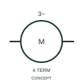

# ANSI/IEEE Three-phase motor with four connections form

IEEE-library form of three-phase motor with four connections: this representation distinguishes the publisher's three-phase motor form with four indicated connections.

[Canonical reference](https://eloragrid.ai/symbols/ansi-three-phase-motor-with-four-connections) · [Structured record](../entries/ansi-three-phase-motor-with-four-connections.json) · [All references](README.md)

Updated: 2026-10-28. Drawing use: SLD, Schematic. Reference families: IEEE / ANSI, Manufacturer.

Graphical convention: IEEE / ANSI. 3 Phase Motor (4 Connections).

## What it represents

This reference locates three-phase motor with four connections in Autodesk's IEEE-oriented 3 phase motors family. This representation distinguishes the publisher's three-phase motor form with four indicated connections. The public library uses HMO14 for its horizontal representation; this is a vendor block name, not an IEEE standards symbol number.
Trace each winding, supply and accessible neutral through the complete machine or transformer connection diagram. Keep the phase arrangement, terminal labels and any clock notation attached to the device; neither the convention label nor this educational outline supplies its ratings.
Verify the purpose of the fourth connection against the selected motor terminal diagram. Do not assume the additional connection is a protective-earth terminal without the equipment documentation. Verify the purpose of the fourth connection against the selected motor terminal diagram. Do not assume the additional connection is a protective-earth terminal without the equipment documentation. The linked functional counterpart explains the same operating role in its own drawing context; agreement of every detailed convention mark is not asserted.

## How to read it

- Verify the purpose of the fourth connection against the selected motor terminal diagram.
- Do not assume the additional connection is a protective-earth terminal without the equipment documentation.

## Drawing checklist

- Identify the associated device, circuit or diagram boundary.
- Verify the purpose of the fourth connection against the selected motor terminal diagram.
- Cross-reference the equipment data, terminal mapping or operating-state legend needed to interpret the form.

## Important distinction

Do not assume the additional connection is a protective-earth terminal without the equipment documentation.

## Facts

- Convention evidence: Autodesk IEEE Symbol Preview: 3 Phase Motors; published form: 3 Phase Motor (4 Connections).
- Public vendor block: HMO14. Vendor library token, not an IEEE symbol number.
- Information added: Verify the purpose of the fourth connection against the selected motor terminal diagram.
- Preview: Independent educational concept; consult the publisher and applicable standard for the exact graphic
- Artwork scope: Original educational geometry. Exact standard graphics, product ratings and terminal pinouts are not certified.

## Public references

- [Autodesk IEEE Symbol Preview — 3 Phase Motors](https://help.autodesk.com/cloudhelp/2021/ENU/AutoCAD-Electrical/files/GUID-392101FD-A88C-4BAC-96CD-1C676094C262.htm) — Autodesk. Public IEEE-oriented 3 Phase Motors table explicitly lists HMO14 as 3 Phase Motor (4 Connections). This supports the vendor convention context, not reproduction of the publisher graphic.

## Related references

- [Three-phase motor with four connections](iec-three-phase-motor-with-four-connections.md)
- [Three-phase motor](motor.md)
- [Generator](generator.md)

Original educational concept geometry, CC BY 4.0. Unitless; not a certified standards glyph or manufacturer footprint.

Elora-authored explanations are CC BY 4.0. Linked standards and manufacturer material retain their own rights. Confirm project requirements using primary sources.
