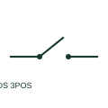

# ANSI/IEEE Three-position disconnector form

IEEE-library form of three-position disconnector: a three-position disconnector selects between two paths and an intermediate position.

[Canonical reference](https://eloragrid.ai/symbols/ansi-three-position-disconnector) · [Structured record](../entries/ansi-three-position-disconnector.json) · [All references](README.md)

Updated: 2026-10-28. Drawing use: SLD, Schematic. Reference families: IEEE / ANSI, Manufacturer.

Graphical convention: IEEE / ANSI. Two Way Disconnect with 3 Positions.

## What it represents

This reference locates three-position disconnector in Autodesk's IEEE-oriented disconnect 1 pole family. A three-position disconnector selects between two paths and an intermediate position. Switchgear schematics must define each position and any linked earth or isolation function explicitly. The public library uses HDS11Q89 for its horizontal representation; this is a vendor block name, not an IEEE standards symbol number.
Use the surrounding circuit labels and the project legend to identify the intended operating condition and connection. Carry the same device reference into the schedule or equipment document so the symbol can be reconciled with its real terminals, function and operating limits.
The middle position must be labelled rather than assumed to be open or earthed. Three positions describe available states; they do not imply that every transition can occur under load. The linked functional counterpart explains the same operating role in its own drawing context; agreement of every detailed convention mark is not asserted.

## How to read it

- The middle position must be labelled rather than assumed to be open or earthed.
- The preview is an original explanation of this function. Match the actual drawing convention to its legend and the selected equipment documentation.

## Drawing checklist

- Name all three positions
- Draw each connected path
- Reference mechanical interlocks

## Important distinction

Three positions describe available states; they do not imply that every transition can occur under load.

## Facts

- Convention evidence: Autodesk IEEE Symbol Preview: Disconnect 1 Pole; published form: Two Way Disconnect with 3 Positions.
- Public vendor block: HDS11Q89. Vendor library token, not an IEEE symbol number.
- Drawing role: Switching path
- Identifier status: The short label is a functional lookup label, not an assigned IEC or IEEE symbol number. Any separately listed Autodesk code is a verified vendor block name.
- Artwork scope: Original educational geometry. Exact standard graphics, product ratings and terminal pinouts are not certified.

## Public references

- [Autodesk IEEE Symbol Preview — Disconnect 1 Pole](https://help.autodesk.com/cloudhelp/2021/ENU/AutoCAD-Electrical/files/GUID-7C62D3DE-6494-4CBF-B3CF-3E3DA309D6A4.htm) — Autodesk. Public IEEE-oriented Disconnect 1 Pole table explicitly lists HDS11Q89 as Two Way Disconnect with 3 Positions. This supports the vendor convention context, not reproduction of the publisher graphic.
- [Elementary switching devices](https://www.electrical-installation.org/enwiki/Elementary_switching_devices) — Schneider Electric — Electrical Installation Guide. Public documentation of this equipment function or named vendor variant; the illustration is independently authored and is not the source graphic.

## Related references

- [Three-position disconnector](three-position-disconnector.md)
- [Disconnector](disconnector.md)
- [Circuit breaker](circuit-breaker.md)

Original educational concept geometry, CC BY 4.0. Unitless; not a certified standards glyph or manufacturer footprint.

Elora-authored explanations are CC BY 4.0. Linked standards and manufacturer material retain their own rights. Confirm project requirements using primary sources.
