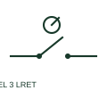

# ANSI/IEEE Three-position selector returning from left form

IEEE-library form of three-position selector returning from left: this three-position selector has a documented spring return from its left position.

[Canonical reference](https://eloragrid.ai/symbols/ansi-three-position-selector-returning-from-left) · [Structured record](../entries/ansi-three-position-selector-returning-from-left.json) · [All references](README.md)

Updated: 2026-10-28. Drawing use: Schematic. Reference families: IEEE / ANSI, Manufacturer.

Graphical convention: IEEE / ANSI. 3 Position Normally Open Return From Left.

## What it represents

This reference locates three-position selector returning from left in Autodesk's IEEE-oriented 3 position selector switches family. This three-position selector has a documented spring return from its left position. Other positions may be stable or have different behaviour, so the return direction must remain explicit. The public library uses HSS113L for its horizontal representation; this is a vendor block name, not an IEEE standards symbol number.
Read the operating mechanism and the contact reference state together. Cross-reference every associated contact to the same device and show which movement, signal or reset changes its condition; the symbol alone does not establish the complete switching sequence.
Establish the rest position and the state after the left-hand command is released. Return from left is not equivalent to return from both outer positions. The linked functional counterpart explains the same operating role in its own drawing context; agreement of every detailed convention mark is not asserted.

## How to read it

- Establish the rest position and the state after the left-hand command is released.
- The preview is an original explanation of this function. Match the actual drawing convention to its legend and the selected equipment documentation.

## Drawing checklist

- Label rest position
- Show return direction
- Provide position/contact schedule

## Important distinction

Return from left is not equivalent to return from both outer positions.

## Facts

- Convention evidence: Autodesk IEEE Symbol Preview: 3 Position Selector Switches; published form: 3 Position Normally Open Return From Left.
- Public vendor block: HSS113L. Vendor library token, not an IEEE symbol number.
- Drawing role: Position selection
- Identifier status: The short label is a functional lookup label, not an assigned IEC or IEEE symbol number. Any separately listed Autodesk code is a verified vendor block name.
- Artwork scope: Original educational geometry. Exact standard graphics, product ratings and terminal pinouts are not certified.

## Public references

- [Autodesk IEEE Symbol Preview — 3 Position Selector Switches](https://help.autodesk.com/cloudhelp/2021/ENU/AutoCAD-Electrical/files/GUID-5B722789-B342-4708-8671-579360D15DCA.htm) — Autodesk. Public IEEE-oriented 3 Position Selector Switches table explicitly lists HSS113L as 3 Position Normally Open Return From Left. This supports the vendor convention context, not reproduction of the publisher graphic.

## Related references

- [Three-position selector returning from left](three-position-selector-returning-from-left.md)
- [Selector switch](selector-switch.md)
- [Changeover contact](changeover-contact.md)

Original educational concept geometry, CC BY 4.0. Unitless; not a certified standards glyph or manufacturer footprint.

Elora-authored explanations are CC BY 4.0. Linked standards and manufacturer material retain their own rights. Confirm project requirements using primary sources.
