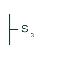

# ANSI three-way switch plan symbol

US plan symbol S3 for a three-way switch, used in pairs to control lights from two locations.

[Canonical reference](https://eloragrid.ai/symbols/ansi-three-way-switch) · [Structured record](../entries/ansi-three-way-switch.json) · [All references](README.md)

Updated: 2026-10-28. Drawing use: GA. Reference families: IEEE / ANSI.

Graphical convention: IEEE / ANSI. Three-way switch, S3.

## What it represents

The US three-way switch is drawn as S with subscript 3. Two S3 symbols appear on the plan at different entries, connected by switch legs to the same lighting group, and the installer runs travellers between them.
Despite the name, a three-way switch has a single changeover contact. The name refers to its three terminals. The equivalent IEC term is a two-way switch. The symbol does not show traveller routing or box fill; the installer plans this from the pair.

## How to read it

- Expect S3 symbols in pairs.
- Look for S4 symbols between them on long runs.

## Drawing checklist

- Show both S3 locations.
- Link to the same fixtures.
- Allow for travellers in conduit fill.

## Important distinction

S4 is a four-way intermediate device; S3 is the changeover switch used at the ends.

## Facts

- Contact: Single changeover, three terminals
- IEC equivalent term: Two-way switch
- Artwork scope: Original educational illustration; the exact ANSI or IEEE graphic and compliance are not certified

## Public references

- [IEEE/ANSI 315-1975: graphic symbols for electrical and electronics diagrams](https://standards.ieee.org/ieee/315/515/) — IEEE Standards Association. Graphic-symbol standards context; not a source of reproduced artwork.

## Related references

- [Two-way light switch plan mark](iec-two-way-light-switch.md)
- [ANSI four-way switch plan symbol](ansi-four-way-switch.md)
- [ANSI single-pole switch plan symbol](ansi-single-pole-switch.md)

Original educational concept geometry, CC BY 4.0. Unitless; not a certified standards glyph or manufacturer footprint.

Elora-authored explanations are CC BY 4.0. Linked standards and manufacturer material retain their own rights. Confirm project requirements using primary sources.
