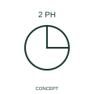

# ANSI/IEEE Two-phase winding connection form

IEEE-library form of two-phase winding connection: this connection qualifier identifies a two-phase winding arrangement in the publisher's reference family.

[Canonical reference](https://eloragrid.ai/symbols/ansi-two-phase-winding-connection) · [Structured record](../entries/ansi-two-phase-winding-connection.json) · [All references](README.md)

Updated: 2026-10-28. Drawing use: SLD, Schematic. Reference families: IEEE / ANSI, Manufacturer.

Graphical convention: IEEE / ANSI. 2 Phase Winding.

## What it represents

This reference locates two-phase winding connection in Autodesk's IEEE-oriented winding family. This connection qualifier identifies a two-phase winding arrangement in the publisher's reference family. The public library uses Q060201 for its horizontal representation; this is a vendor block name, not an IEEE standards symbol number.
Trace each winding, supply and accessible neutral through the complete machine or transformer connection diagram. Keep the phase arrangement, terminal labels and any clock notation attached to the device; neither the convention label nor this educational outline supplies its ratings.
Record terminal labels and the actual phase relationship in the machine or transformer schedule. A two-phase winding indication should not be inferred from a two-wire supply label. Record terminal labels and the actual phase relationship in the machine or transformer schedule. A two-phase winding indication should not be inferred from a two-wire supply label. The linked functional counterpart explains the same operating role in its own drawing context; agreement of every detailed convention mark is not asserted.

## How to read it

- Record terminal labels and the actual phase relationship in the machine or transformer schedule.
- A two-phase winding indication should not be inferred from a two-wire supply label.

## Drawing checklist

- Identify the associated device, circuit or diagram boundary.
- Record terminal labels and the actual phase relationship in the machine or transformer schedule.
- Cross-reference the equipment data, terminal mapping or operating-state legend needed to interpret the form.

## Important distinction

A two-phase winding indication should not be inferred from a two-wire supply label.

## Facts

- Convention evidence: Autodesk IEEE Symbol Preview: Winding; published form: 2 Phase Winding.
- Public vendor block: Q060201. Vendor library token, not an IEEE symbol number.
- Information added: Record terminal labels and the actual phase relationship in the machine or transformer schedule.
- Preview: Independent educational concept; consult the publisher and applicable standard for the exact graphic
- Artwork scope: Original educational geometry. Exact standard graphics, product ratings and terminal pinouts are not certified.

## Public references

- [Autodesk IEEE Symbol Preview: Winding](https://help.autodesk.com/cloudhelp/2021/ENU/AutoCAD-Electrical/files/GUID-19F0C368-8E22-46C6-BFC1-D311EED77CA5.htm) — Autodesk. Public IEEE-oriented Winding table explicitly lists Q060201 as 2 Phase Winding. This supports the vendor convention context, not reproduction of the publisher graphic.

## Related references

- [Two-phase winding connection](iec-two-phase-winding-connection.md)
- [Three-phase motor](motor.md)
- [Generator](generator.md)

Original educational concept geometry, CC BY 4.0. Unitless; not a certified standards glyph or manufacturer footprint.

Elora-authored explanations are CC BY 4.0. Linked standards and manufacturer material retain their own rights. Confirm project requirements using primary sources.
