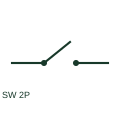

# ANSI/IEEE Two-pole power switch form

IEEE-library form of two-pole power switch: a two-pole power switch operates two circuit conductors through a common device.

[Canonical reference](https://eloragrid.ai/symbols/ansi-two-pole-power-switch) · [Structured record](../entries/ansi-two-pole-power-switch.json) · [All references](README.md)

Updated: 2026-10-28. Drawing use: SLD, Schematic. Reference families: IEEE / ANSI, Manufacturer.

Graphical convention: IEEE / ANSI. 2P Power Switch.

## What it represents

This reference locates two-pole power switch in Autodesk's IEEE-oriented power switches family. A two-pole power switch operates two circuit conductors through a common device. The schematic may use separate pole elements linked by a mechanism annotation. The public library uses HCB11Q50 for its horizontal representation; this is a vendor block name, not an IEEE standards symbol number.
Read the operating mechanism and the contact reference state together. Cross-reference every associated contact to the same device and show which movement, signal or reset changes its condition; the symbol alone does not establish the complete switching sequence.
Identify whether the two poles are phases, a phase and neutral, or DC conductors. Two poles do not necessarily mean a two-phase supply. The linked functional counterpart explains the same operating role in its own drawing context; agreement of every detailed convention mark is not asserted.

## How to read it

- Identify whether the two poles are phases, a phase and neutral, or DC conductors.
- The preview is an original explanation of this function. Match the actual drawing convention to its legend and the selected equipment documentation.

## Drawing checklist

- Name both conductors
- Show common operator
- Reference switching ratings

## Important distinction

Two poles do not necessarily mean a two-phase supply.

## Facts

- Convention evidence: Autodesk IEEE Symbol Preview: Power Switches; published form: 2P Power Switch.
- Public vendor block: HCB11Q50. Vendor library token, not an IEEE symbol number.
- Drawing role: Switching path
- Identifier status: The short label is a functional lookup label, not an assigned IEC or IEEE symbol number. Any separately listed Autodesk code is a verified vendor block name.
- Artwork scope: Original educational geometry. Exact standard graphics, product ratings and terminal pinouts are not certified.

## Public references

- [Autodesk IEEE Symbol Preview: Power Switches](https://help.autodesk.com/cloudhelp/2021/ENU/AutoCAD-Electrical/files/GUID-E57D79F6-E6C4-4B78-95DC-62F16642C95B.htm) — Autodesk. Public IEEE-oriented Power Switches table explicitly lists HCB11Q50 as 2P Power Switch. This supports the vendor convention context, not reproduction of the publisher graphic.

## Related references

- [Two-pole power switch](two-pole-power-switch.md)
- [Disconnector](disconnector.md)
- [Circuit breaker](circuit-breaker.md)

Original educational concept geometry, CC BY 4.0. Unitless; not a certified standards glyph or manufacturer footprint.

Elora-authored explanations are CC BY 4.0. Linked standards and manufacturer material retain their own rights. Confirm project requirements using primary sources.
