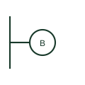

# ANSI wall lighting outlet plan symbol

US plan symbol for a wall lighting outlet, a circle attached to the wall line by a short stem.

[Canonical reference](https://eloragrid.ai/symbols/ansi-wall-lighting-outlet) · [Structured record](../entries/ansi-wall-lighting-outlet.json) · [All references](README.md)

Updated: 2026-10-28. Drawing use: GA. Reference families: IEEE / ANSI.

Graphical convention: IEEE / ANSI. Wall lighting outlet.

## What it represents

Wall-mounted lighting outlets, such as sconces and bracket lights, are drawn in US plans as a circle connected to the wall line by a short line. The fixture type letter is placed inside or beside it.
Height above floor is normally noted, as sconces are set to suit architectural features. The switch letter links it to its controlling switch. The symbol does not show the fixture size or the light distribution.

## How to read it

- Note the stem to the wall.
- Read height notes.

## Drawing checklist

- Give mounting height.
- Key to fixture schedule.
- Link to switch.

## Important distinction

The IEC wall luminaire uses a crossed circle on a bracket; the US form uses a plain circle on a stem.

## Facts

- Graphic form: Circle on a short stem from the wall
- Key data: Mounting height
- Artwork scope: Original educational illustration; the exact ANSI or IEEE graphic and compliance are not certified

## Public references

- [IEEE/ANSI 315-1975: graphic symbols for electrical and electronics diagrams](https://standards.ieee.org/ieee/315/515/) — IEEE Standards Association. Graphic-symbol standards context and official status; not a source of reproduced artwork.

## Related references

- [ANSI ceiling lighting outlet plan symbol](ansi-ceiling-lighting-outlet.md)
- [Wall-mounted luminaire plan mark](iec-wall-mounted-luminaire.md)

Original educational concept geometry, CC BY 4.0. Unitless; not a certified standards glyph or manufacturer footprint.

Elora-authored explanations are CC BY 4.0. Linked standards and manufacturer material retain their own rights. Confirm project requirements using primary sources.
