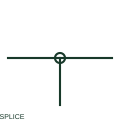

# ANSI/IEEE wire splice symbol

IEEE-oriented graphical reference for wire splice, with public vendor evidence and drawing-reading notes.

[Canonical reference](https://eloragrid.ai/symbols/ansi-wire-splice) · [Structured record](../entries/ansi-wire-splice.json) · [All references](README.md)

Updated: 2026-10-27. Drawing use: Schematic. Reference families: IEEE / ANSI, Manufacturer.

Graphical convention: IEEE / ANSI. Autodesk IEEE-oriented Splice Symbols functional form.

## What it represents

The splice form identifies intentional continuity among documented conductors without a detachable mating connection. A splice identifier and wiring detail establish its construction and joined conductors; nearby lines alone do not establish a splice.
This is a convention-specific lookup based on the publisher's IEEE-labelled preview. The geometry here is independently drawn to explain the connection or operation; it is not a certified reproduction of the standard graphic.

## How to read it

- Distinguish a joined node from an unconnected conductor crossing.
- Read the selected library and the project legend together. A vendor block identifier is meaningful within its named library and is not a universal standard-symbol code.

## Drawing checklist

- Identify splice tag
- List joined wires
- Reference construction detail

## Important distinction

A splice creates permanent continuity while a connector provides a separable mating interface.

## Facts

- Convention evidence: Autodesk IEEE Symbol Preview — Splice Symbols
- Public vendor block name: HSP1001 (Autodesk identifier; not an IEEE symbol number)
- Standards context: IEEE/ANSI 315-1975 covers diagram graphics. IEEE lists this edition as Inactive-Reserved.
- Artwork scope: Original functional illustration; exact standard glyph and compliance are not certified

## Public references

- [Autodesk IEEE Symbol Preview — Splice Symbols](https://help.autodesk.com/cloudhelp/2021/ENU/AutoCAD-Electrical/files/GUID-CF40D77D-BC49-4CDE-9396-C439966BCAB2.htm) — Autodesk. Exact public IEEE-oriented category page verifying the component name and vendor block identifier.
- [IEEE/ANSI 315-1975: graphic symbols for electrical and electronics diagrams](https://standards.ieee.org/ieee/315/515/) — IEEE Standards Association. Graphic-symbol standards context and official status; not a source of reproduced artwork.

## Related references

- [Wire splice](wire-splice.md)
- [Terminal connection](terminal.md)
- [PLC input / output](plc-io.md)

Original educational concept geometry, CC BY 4.0. Unitless; not a certified standards glyph or manufacturer footprint.

Elora-authored explanations are CC BY 4.0. Linked standards and manufacturer material retain their own rights. Confirm project requirements using primary sources.
