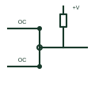

# ANSI wired-AND connection

Several open-collector outputs joined on one pulled-up line, so any output pulling low makes the line low.

[Canonical reference](https://eloragrid.ai/symbols/ansi-wired-and-connection) · [Structured record](../entries/ansi-wired-and-connection.json) · [All references](README.md)

Updated: 2026-10-28. Drawing use: Schematic. Reference families: IEEE / ANSI, Manufacturer.

Graphical convention: IEEE / ANSI. Open-collector outputs joined to a common pulled-up line.

## What it represents

A wired-AND connection is formed by joining open-collector or open-drain outputs to a single line with one pull-up. The line is high only when every output is off, so in positive logic the result is the AND of the individual output states. Some schematics draw a small AND outline around the junction to make the implied function visible.
Shared interrupt lines, ready signals and I2C-style buses rely on this arrangement. A drawing should show every output on the net, the single pull-up, and the supply, because adding or removing a driver changes the logic and the pull-up current.
The connection only works with open-circuit outputs. Joining push-pull outputs in the same way causes contention and possible damage, so the output type of each gate must be checked.

## How to read it

- Check that every joined output is open collector or open drain.
- There should be one pull-up for the whole net.

## Drawing checklist

- Show all contributing outputs on the shared net.
- Draw a single pull-up with its value and supply.
- Mark the open-circuit output type on each driver.

## Important distinction

A wired-OR uses open-emitter outputs with a pull-down; wired-AND uses open-collector outputs with a pull-up.

## Facts

- Required output type: Open collector or open drain
- Resulting function: AND in positive logic
- Artwork scope: Original educational illustration; consult the applicable standard and the selected device documentation for the exact graphic

## Public references

- [Overview of IEEE Standard 91-1984: explanation of logic symbols (SDYZ001A)](https://www.ti.com/lit/ml/sdyz001a/sdyz001a.pdf) — Texas Instruments. States that open-collector outputs are capable of positive-logic wired-AND connection.
- [SNx4HC05 hex inverters with open-drain outputs](https://www.ti.com/lit/ds/symlink/sn74hc05.pdf) — Texas Instruments. Manufacturer open-drain output documentation.

## Related references

- [Open-collector buffer](open-collector-buffer.md)
- [ANSI open-collector inverter](ansi-open-collector-inverter.md)
- [IEC open-circuit output, L-type (open collector)](iec-open-circuit-output-l-type.md)

Original educational concept geometry, CC BY 4.0. Unitless; not a certified standards glyph or manufacturer footprint.

Elora-authored explanations are CC BY 4.0. Linked standards and manufacturer material retain their own rights. Confirm project requirements using primary sources.
