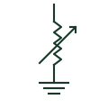

# Arc suppression coil

An adjustable reactor between neutral and earth tuned to cancel the network capacitive earth-fault current.

[Canonical reference](https://eloragrid.ai/symbols/arc-suppression-coil) · [Structured record](../entries/arc-suppression-coil.json) · [All references](README.md)

Updated: 2026-10-28. Drawing use: SLD. Reference families: IEC, IEEE / ANSI.

## What it represents

An arc suppression coil is a reactor connected between the system neutral and earth, tuned so that its inductive current balances the capacitive current that flows during a single phase-to-earth fault. The residual fault current becomes very small, so transient arcing faults often self-extinguish and the network can keep running with a sustained earth fault.
Drawings show an inductor with an adjustment arrow between a transformer or earthing transformer neutral and earth, often with a parallel resistor switched in briefly to help fault location. Automatic tuning controllers and neutral voltage measurement are drawn alongside.
Resonant earthing needs dedicated earth-fault detection, such as transient or admittance-based protection, because fault current is too small for simple overcurrent relays. The symbol does not show the tuning range or the detection method.

## How to read it

- An adjustment arrow on the reactor shows tuning capability.
- Look for a parallel resistor used for fault location.

## Drawing checklist

- State tuning range in amperes.
- Show earthing transformer and resistor.
- Reference earth-fault detection method.

## Important distinction

An arc suppression coil cancels capacitive fault current; a neutral earthing resistor limits fault current but does not cancel it.

## Facts

- Element: Adjustable reactor
- Connection: Neutral to earth
- Detection required: Sensitive or transient earth-fault protection
- Preview: Independent educational illustration; consult the applicable standard and project legend for the exact graphic

## Public references

- [Residual current and neutral-earthing protection context](https://new.abb.com/medium-voltage/digital-substations/campaigns/earth-fault-protection-portfolio/earth-fault-offering) — ABB. Public earth-fault and neutral earthing protection context.
- [AutoCAD Electrical: Reactors and inductors](https://help.autodesk.com/cloudhelp/2021/ENU/AutoCAD-Electrical/files/GUID-BAD50DBF-0951-44A0-BB4C-A57B4A4ED895.htm) — Autodesk. Public reactor symbol family context.

## Related references

- [Neutral earthing resistor](neutral-earthing-resistor.md)
- [Adjustable-core inductor](adjustable-core-inductor.md)
- [Transient or intermittent earth-fault protection](67nief-transient-or-intermittent-earth-fault-protection.md)
- [Zigzag winding connection](zigzag-winding-connection.md)

Original educational concept geometry, CC BY 4.0. Unitless; not a certified standards glyph or manufacturer footprint.

Elora-authored explanations are CC BY 4.0. Linked standards and manufacturer material retain their own rights. Confirm project requirements using primary sources.
