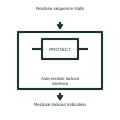

# Auto-reclose lockout interface

Prevents further automatic closing after the defined unsuccessful-reclose condition.

[Canonical reference](https://eloragrid.ai/symbols/auto-reclose-lockout-interface) · [Structured record](../entries/auto-reclose-lockout-interface.json) · [All references](README.md)

Updated: 2026-11-03. Drawing use: Schematic. Reference families: Manufacturer.

Representation: functional-block; installation focus: substations.
Reclose sequence state
Reclose lockout indication

## What it represents

Prevents further automatic closing after the defined unsuccessful-reclose condition. A protection scheme combines measurements, decision elements and communication or trip outputs to protect a defined part of the network. A function number names a job; the scheme interface shows how that job connects to other equipment.
In a substation feeder bay, local current and voltage measurements may combine with a remote-end signal before the protection issues the assigned trip request. Backup actions use their own defined initiations and supervision. For this reference, the drawing identifies “Reclose sequence state” at the input and “Reclose lockout indication” at the output. Reset philosophy must be specified separately.
Keep each protected zone, initiating quantity, blocking signal and trip destination distinct. Settings, communication performance and coordination require the approved protection study and selected relay documentation. The functional block is an independent explanation of this named application. Equipment-specific ratings, terminal connections and operating conditions must be established in the project documentation.

## How to read it

- Start at the named input: Reclose sequence state. Identify its source device or document and the state represented on the drawing.
- Follow the named output: Reclose lockout indication. Cross-reference its destination and separate the command from confirmation that the equipment responded.
- Reset philosophy must be specified separately.
- Keep each protected zone, initiating quantity, blocking signal and trip destination distinct. Settings, communication performance and coordination require the approved protection study and selected relay documentation.

## Drawing checklist

- Label the source and connection reference for reclose sequence state.
- Identify the destination and defined state of reclose lockout indication.
- Record the equipment or control-document revision supporting this functional block.
- Check this application limit in the project design: Reset philosophy must be specified separately.

## Important distinction

Reset philosophy must be specified separately. This reference describes the named application; it does not establish a new IEC graphical symbol, an ANSI device-function number or an exact manufacturer connection diagram.

## Facts

- Representation: Functional block
- Installation focus: Substations
- Input / boundary: Reclose sequence state
- Output / connection: Reclose lockout indication
- Lookup label: ALI is a library lookup label, not a standard device designation.

## Public references

- [SEL-411L line differential protection overview](https://selinc.com/products/411l/) — Schweitzer Engineering Laboratories. Public technical context for substation protection scheme interfaces. Line protection, breaker failure, communications and protection coordination. The application text and educational graphic are independently authored; the publisher does not certify this representation.

## Related references

- [Circuit-breaker failure protection](50bf-circuit-breaker-failure-protection.md)
- [Busbar differential protection](87b-busbar-differential-protection.md)
- [Single-pole trip selection block](single-pole-trip-selection-block.md)

Original educational concept geometry, CC BY 4.0. Unitless; not a certified standards glyph or manufacturer footprint.

Elora-authored explanations are CC BY 4.0. Linked standards and manufacturer material retain their own rights. Confirm project requirements using primary sources.
