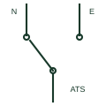

# Automatic transfer switch

A mechanically switched changeover device that automatically moves a load from a failed normal source to an alternate source.

[Canonical reference](https://eloragrid.ai/symbols/automatic-transfer-switch) · [Structured record](../entries/automatic-transfer-switch.json) · [All references](README.md)

Updated: 2026-10-28. Drawing use: SLD, Schematic. Reference families: IEC, IEEE / ANSI.

## What it represents

An automatic transfer switch monitors the normal supply and, when voltage or frequency goes out of limits, signals the generator to start and transfers the load to the alternate source once it is ready. When the normal supply returns and is stable, it transfers back after a time delay. Most units use an open-transition break-before-make sequence.
Single-line diagrams show a changeover contact with two incoming poles labelled N and E or S1 and S2 and one outgoing load connection, or two interlocked switching devices. The controller and generator start signal are often noted beside it, and a neutral pole may be switched for separately derived systems.
The symbol does not show the timing, whether the neutral is switched, or whether the transition is open, closed or delayed. Those features determine earthing behaviour, motor reconnection and coordination with the network operator.

## How to read it

- Check whether three or four poles are switched.
- Read the transition type from the notes.

## Drawing checklist

- State current rating, poles and transition type.
- Show both sources and the generator start signal.
- Reference controller timing settings.

## Important distinction

An automatic transfer switch operates without an operator; a manual transfer switch needs someone to move it.

## Facts

- Switching: Mechanical, interlocked
- Typical transition: Open, break-before-make
- Inputs: Normal and alternate sources
- Preview: Independent educational illustration; consult the applicable standard and project legend for the exact graphic

## Public references

- [Transfer switch fundamentals](https://www.cummins.com/sites/default/files/2026-04/2023-sep-transfer-switch-fundamentals.pdf) — Cummins. Public transfer switch fundamentals.
- [ATS controllers](https://www.deif.com/products/controllers/ats-controller/) — DEIF. Public automatic transfer controller page describing mains and generator transfer.

## Related references

- [Transfer-switch assembly](transfer-switch.md)
- [Manual transfer switch](manual-transfer-switch.md)
- [Closed-transition transfer switch](closed-transition-transfer-switch.md)
- [Automatic selective control or transfer relay](83-automatic-selective-control-or-transfer-relay.md)

Original educational concept geometry, CC BY 4.0. Unitless; not a certified standards glyph or manufacturer footprint.

Elora-authored explanations are CC BY 4.0. Linked standards and manufacturer material retain their own rights. Confirm project requirements using primary sources.
