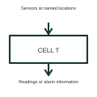

# Battery cell temperature monitor

A cell temperature monitor reads sensors located at specified points in a battery assembly.

[Canonical reference](https://eloragrid.ai/symbols/battery-cell-temperature-monitor) · [Structured record](../entries/battery-cell-temperature-monitor.json) · [All references](README.md)

Updated: 2026-10-27. Drawing use: Schematic. Reference families: Manufacturer.

## What it represents

A cell temperature monitor reads sensors located at specified points in a battery assembly.
A battery controller can use temperature readings alongside cell voltage measurements.
Place temperature-sensor symbols at the locations being measured and map them to the monitoring channels. A sensor on one cell, a busbar or an enclosure wall reports a different location. Keep the location labels visible so the drawing does not suggest one reading covers the complete battery. This is original functional artwork, not a certified standard graphic or device pinout.

## How to read it

- Name each sensor location and channel.
- Identify the selected sensor type and connection.
- Show where temperature readings or alarms are sent.
- A sensor measures its location; one reading does not describe every cell's temperature.

## Drawing checklist

- Name each sensor location and channel.
- Identify the selected sensor type and connection.
- Show where temperature readings or alarms are sent.

## Important distinction

A sensor measures its location; one reading does not describe every cell's temperature.

## Facts

- Representation type: Original functional block; not a certified IEC or IEEE graphic
- Concept input: Sensors at named locations
- Concept output: Readings or alarm information

## Public references

- [Battery monitors and balancers](https://www.ti.com/product-category/battery-management-ics/battery-monitors-balancers/overview.html) — Texas Instruments. Battery monitors and balancers: public technical context for the named function. Product and compliance details remain with the publisher.

## Related references

- [Battery storage cabinet](battery-cabinet.md)
- [Battery cell voltage monitor](battery-cell-voltage-monitor.md)
- [Passive battery cell balancer](passive-cell-balancer.md)
- [Active battery cell balancer](active-cell-balancer.md)

Original educational concept geometry, CC BY 4.0. Unitless; not a certified standards glyph or manufacturer footprint.

Elora-authored explanations are CC BY 4.0. Linked standards and manufacturer material retain their own rights. Confirm project requirements using primary sources.
