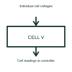

# Battery cell voltage monitor

A cell voltage monitor measures individual cells within a series-connected battery.

[Canonical reference](https://eloragrid.ai/symbols/battery-cell-voltage-monitor) · [Structured record](../entries/battery-cell-voltage-monitor.json) · [All references](README.md)

Updated: 2026-10-27. Drawing use: Schematic. Reference families: Manufacturer.

## What it represents

A cell voltage monitor measures individual cells within a series-connected battery.
A pack controller can compare cell voltages instead of seeing only the total pack voltage.
Show a separate measurement connection for each monitored cell in a series string. Adding the cell voltages gives a pack voltage, but it can conceal one cell being higher or lower than its neighbours. Label cell order so the measurement channels can be traced to the correct physical cells. This is original functional artwork, not a certified standard graphic or device pinout.

## How to read it

- Identify cell order and the monitor’s channel mapping.
- Separate sense wires from the main current path.
- Reference the selected monitor’s input connection requirements.
- A normal total pack voltage can hide differences between individual cells.

## Drawing checklist

- Identify cell order and the monitor’s channel mapping.
- Separate sense wires from the main current path.
- Reference the selected monitor’s input connection requirements.

## Important distinction

A normal total pack voltage can hide differences between individual cells.

## Facts

- Representation type: Original functional block; not a certified IEC or IEEE graphic
- Concept input: Individual cell voltages
- Concept output: Cell readings to controller

## Public references

- [Battery monitors and balancers](https://www.ti.com/product-category/battery-management-ics/battery-monitors-balancers/overview.html) — Texas Instruments. Battery monitors and balancers: public technical context for the named function. Product and compliance details remain with the publisher.

## Related references

- [Battery storage cabinet](battery-cabinet.md)
- [Passive battery cell balancer](passive-cell-balancer.md)
- [Active battery cell balancer](active-cell-balancer.md)
- [Battery cell temperature monitor](battery-cell-temperature-monitor.md)

Original educational concept geometry, CC BY 4.0. Unitless; not a certified standards glyph or manufacturer footprint.

Elora-authored explanations are CC BY 4.0. Linked standards and manufacturer material retain their own rights. Confirm project requirements using primary sources.
