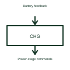

# Battery charger controller

A battery charger controller manages the charging process for the selected battery system.

[Canonical reference](https://eloragrid.ai/symbols/battery-charger-controller) · [Structured record](../entries/battery-charger-controller.json) · [All references](README.md)

Updated: 2026-10-27. Drawing use: Schematic. Reference families: Manufacturer.

## What it represents

A battery charger controller manages the charging process for the selected battery system.
A charger can regulate its output according to the battery's charging requirements.
Draw the controller beside the power-conversion stage it commands. The controller decides how charging should progress; the power stage moves the energy. Identify the battery-feedback signals separately so a reader can distinguish charging power from the measurements used to control it. This is original functional artwork, not a certified standard graphic or device pinout.

## How to read it

- Identify the battery type and charging requirements.
- Separate power-stage connections from feedback signals.
- Show the charge-enable and charge-status interfaces.
- A charger controller is not the battery cells or necessarily the complete power converter.

## Drawing checklist

- Identify the battery type and charging requirements.
- Separate power-stage connections from feedback signals.
- Show the charge-enable and charge-status interfaces.

## Important distinction

A charger controller is not the battery cells or necessarily the complete power converter.

## Facts

- Representation type: Original functional block; not a certified IEC or IEEE graphic
- Concept input: Battery feedback
- Concept output: Power-stage commands

## Public references

- [Battery management functions](https://www.ti.com/product-category/battery-management-ics/overview.html) — Texas Instruments. Battery management functions: public technical context for the named function. Product and compliance details remain with the publisher.

## Related references

- [Battery](battery.md)
- [Battery fuel gauge](battery-fuel-gauge.md)
- [Battery protection controller](battery-protection-controller.md)
- [Power converter / inverter](power-converter.md)

Original educational concept geometry, CC BY 4.0. Unitless; not a certified standards glyph or manufacturer footprint.

Elora-authored explanations are CC BY 4.0. Linked standards and manufacturer material retain their own rights. Confirm project requirements using primary sources.
