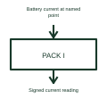

# Battery pack current measurement

Pack-current measurement reports current entering or leaving the battery.

[Canonical reference](https://eloragrid.ai/symbols/battery-current-measurement) · [Structured record](../entries/battery-current-measurement.json) · [All references](README.md)

Updated: 2026-10-27. Drawing use: Schematic. Reference families: Manufacturer.

## What it represents

Pack-current measurement reports current entering or leaving the battery.
A battery controller can use current direction and magnitude when managing charge and discharge.
Mark the exact conductor or shunt where current is measured and define the positive direction. Charging and discharging can produce opposite signs. The measurement can support a battery estimate, but a current-reading block alone does not contain the history or battery model needed for that estimate. This is original functional artwork, not a certified standard graphic or device pinout.

## How to read it

- Identify the sensing method and measurement location.
- Define positive current as charging or discharging.
- Show the measurement output and reference domain.
- A current measurement alone does not establish cell state of charge or battery health.

## Drawing checklist

- Identify the sensing method and measurement location.
- Define positive current as charging or discharging.
- Show the measurement output and reference domain.

## Important distinction

A current measurement alone does not establish cell state of charge or battery health.

## Facts

- Representation type: Original functional block; not a certified IEC or IEEE graphic
- Concept input: Battery current at named point
- Concept output: Signed current reading

## Public references

- [Battery-pack measurement and control](https://www.ti.com/applications/automotive/hev-ev-powertrain/hev-ev-battery-management-system-bms/overview.html) — Texas Instruments. Battery-pack measurement and control: public technical context for the named function. Product and compliance details remain with the publisher.

## Related references

- [Battery precharge assembly](ga-battery-precharge-assembly.md)
- [Battery pack monitor](battery-pack-monitor.md)
- [Battery precharge circuit](battery-precharge-circuit.md)
- [Battery insulation monitoring function](battery-insulation-monitor.md)

Original educational concept geometry, CC BY 4.0. Unitless; not a certified standards glyph or manufacturer footprint.

Elora-authored explanations are CC BY 4.0. Linked standards and manufacturer material retain their own rights. Confirm project requirements using primary sources.
