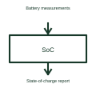

# Battery fuel gauge

A battery fuel gauge estimates how much usable charge remains in a battery.

[Canonical reference](https://eloragrid.ai/symbols/battery-fuel-gauge) · [Structured record](../entries/battery-fuel-gauge.json) · [All references](README.md)

Updated: 2026-10-27. Drawing use: Schematic. Reference families: Manufacturer.

## What it represents

A battery fuel gauge estimates how much usable charge remains in a battery.
An operator display can show a charge estimate instead of only battery voltage.
Show the measurements entering the gauge and the charge estimate sent to the controller. A fuel gauge is like a battery dashboard: its estimate depends on the battery model and measurements, rather than simply reading the voltage once. Keep the measurement path separate from the battery’s main power cables. This is original functional artwork, not a certified standard graphic or device pinout.

## How to read it

- Identify the battery chemistry and pack arrangement.
- Label measured voltage, current and temperature where used.
- Name the reported estimate and the controller receiving it.
- An estimate of remaining charge is different from a guarantee of remaining operating time.

## Drawing checklist

- Identify the battery chemistry and pack arrangement.
- Label measured voltage, current and temperature where used.
- Name the reported estimate and the controller receiving it.

## Important distinction

An estimate of remaining charge is different from a guarantee of remaining operating time.

## Facts

- Representation type: Original functional block; not a certified IEC or IEEE graphic
- Concept input: Battery measurements
- Concept output: State-of-charge report

## Public references

- [Battery management functions](https://www.ti.com/product-category/battery-management-ics/overview.html) — Texas Instruments. Battery management functions: public technical context for the named function. Product and compliance details remain with the publisher.

## Related references

- [Battery](battery.md)
- [Battery charger controller](battery-charger-controller.md)
- [Battery protection controller](battery-protection-controller.md)
- [Power converter / inverter](power-converter.md)

Original educational concept geometry, CC BY 4.0. Unitless; not a certified standards glyph or manufacturer footprint.

Elora-authored explanations are CC BY 4.0. Linked standards and manufacturer material retain their own rights. Confirm project requirements using primary sources.
