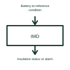

# Battery insulation monitoring function

An insulation monitoring function assesses the electrical insulation between the monitored circuit and its reference structure.

[Canonical reference](https://eloragrid.ai/symbols/battery-insulation-monitor) · [Structured record](../entries/battery-insulation-monitor.json) · [All references](README.md)

Updated: 2026-10-27. Drawing use: Schematic. Reference families: Manufacturer.

## What it represents

An insulation monitoring function assesses the electrical insulation between the monitored circuit and its reference structure.
A floating battery system can monitor its insulation condition relative to chassis.
Show the monitored battery circuit and the chassis or earth reference used by the selected monitoring system. Its purpose is to assess unwanted leakage through insulation, not to measure normal load current. Label the reference arrangement because insulation monitoring depends on how the electrical system is connected. This is original functional artwork, not a certified standard graphic or device pinout.

## How to read it

- Identify the monitored circuit and its reference structure.
- Show the monitor’s alarm or status output.
- Reference the selected monitor’s system-compatibility requirements.
- Insulation monitoring and ordinary load-current measurement are different functions.

## Drawing checklist

- Identify the monitored circuit and its reference structure.
- Show the monitor’s alarm or status output.
- Reference the selected monitor’s system-compatibility requirements.

## Important distinction

Insulation monitoring and ordinary load-current measurement are different functions.

## Facts

- Representation type: Original functional block; not a certified IEC or IEEE graphic
- Concept input: Battery-to-reference condition
- Concept output: Insulation status or alarm

## Public references

- [Battery-pack measurement and control](https://www.ti.com/applications/automotive/hev-ev-powertrain/hev-ev-battery-management-system-bms/overview.html) — Texas Instruments. Battery-pack measurement and control: public technical context for the named function. Product and compliance details remain with the publisher.

## Related references

- [Battery precharge assembly](ga-battery-precharge-assembly.md)
- [Battery pack monitor](battery-pack-monitor.md)
- [Battery precharge circuit](battery-precharge-circuit.md)
- [Battery pack current measurement](battery-current-measurement.md)

Original educational concept geometry, CC BY 4.0. Unitless; not a certified standards glyph or manufacturer footprint.

Elora-authored explanations are CC BY 4.0. Linked standards and manufacturer material retain their own rights. Confirm project requirements using primary sources.
