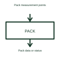

# Battery pack monitor

A pack monitor measures quantities associated with the complete battery pack.

[Canonical reference](https://eloragrid.ai/symbols/battery-pack-monitor) · [Structured record](../entries/battery-pack-monitor.json) · [All references](README.md)

Updated: 2026-10-27. Drawing use: Schematic. Reference families: Manufacturer.

## What it represents

A pack monitor measures quantities associated with the complete battery pack.
A system can monitor pack current and voltage in addition to measurements made at individual cells.
Use this block for measurements associated with the pack as a whole, such as its total voltage or current. Show any separate cell monitor explicitly. This helps the reader distinguish the pack’s overall electrical state from the individual-cell information needed elsewhere in a battery-management system. This is original functional artwork, not a certified standard graphic or device pinout.

## How to read it

- Name the pack-level quantities actually measured.
- Identify any separate cell-monitor connection.
- Show the data or status interface to the battery controller.
- Pack-level measurement and cell-level monitoring provide different information.

## Drawing checklist

- Name the pack-level quantities actually measured.
- Identify any separate cell-monitor connection.
- Show the data or status interface to the battery controller.

## Important distinction

Pack-level measurement and cell-level monitoring provide different information.

## Facts

- Representation type: Original functional block; not a certified IEC or IEEE graphic
- Concept input: Pack measurement points
- Concept output: Pack data or status

## Public references

- [Battery-pack measurement and control](https://www.ti.com/applications/automotive/hev-ev-powertrain/hev-ev-battery-management-system-bms/overview.html) — Texas Instruments. Battery-pack measurement and control: public technical context for the named function. Product and compliance details remain with the publisher.

## Related references

- [Battery precharge assembly](ga-battery-precharge-assembly.md)
- [Battery precharge circuit](battery-precharge-circuit.md)
- [Battery insulation monitoring function](battery-insulation-monitor.md)
- [Battery pack current measurement](battery-current-measurement.md)

Original educational concept geometry, CC BY 4.0. Unitless; not a certified standards glyph or manufacturer footprint.

Elora-authored explanations are CC BY 4.0. Linked standards and manufacturer material retain their own rights. Confirm project requirements using primary sources.
