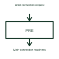

# Battery precharge circuit

A precharge circuit limits the initial current used to charge downstream capacitance before a main connection closes.

[Canonical reference](https://eloragrid.ai/symbols/battery-precharge-circuit) · [Structured record](../entries/battery-precharge-circuit.json) · [All references](README.md)

Updated: 2026-10-27. Drawing use: Schematic. Reference families: Manufacturer.

## What it represents

A precharge circuit limits the initial current used to charge downstream capacitance before a main connection closes.
A battery system can charge a converter's DC-link capacitors through a controlled precharge path.
Show the current-limited startup branch separately from the main connection. Downstream capacitors can initially act like a large demand for current; precharge fills them more gradually before the main path is established. The control sequence must therefore distinguish precharge from normal operation. This is original functional artwork, not a certified standard graphic or device pinout.

## How to read it

- Identify the limited-current branch and main switching path.
- Show the voltage or condition used to end precharge.
- Reference the selected startup sequence and fault response.
- Precharge is a startup function, not the normal full-load power path.

## Drawing checklist

- Identify the limited-current branch and main switching path.
- Show the voltage or condition used to end precharge.
- Reference the selected startup sequence and fault response.

## Important distinction

Precharge is a startup function, not the normal full-load power path.

## Facts

- Representation type: Original functional block; not a certified IEC or IEEE graphic
- Concept input: Initial connection request
- Concept output: Main-connection readiness

## Public references

- [Battery-pack measurement and control](https://www.ti.com/applications/automotive/hev-ev-powertrain/hev-ev-battery-management-system-bms/overview.html) — Texas Instruments. Battery-pack measurement and control: public technical context for the named function. Product and compliance details remain with the publisher.

## Related references

- [Battery precharge assembly](ga-battery-precharge-assembly.md)
- [Battery pack monitor](battery-pack-monitor.md)
- [Battery insulation monitoring function](battery-insulation-monitor.md)
- [Battery pack current measurement](battery-current-measurement.md)

Original educational concept geometry, CC BY 4.0. Unitless; not a certified standards glyph or manufacturer footprint.

Elora-authored explanations are CC BY 4.0. Linked standards and manufacturer material retain their own rights. Confirm project requirements using primary sources.
