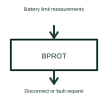

# Battery protection controller

A battery protection controller monitors selected limits and requests protective action when its conditions are reached.

[Canonical reference](https://eloragrid.ai/symbols/battery-protection-controller) · [Structured record](../entries/battery-protection-controller.json) · [All references](README.md)

Updated: 2026-10-27. Drawing use: Schematic. Reference families: Manufacturer.

## What it represents

A battery protection controller monitors selected limits and requests protective action when its conditions are reached.
A pack can disconnect its output after a monitored fault is detected.
Use separate labels for sensing a problem and disconnecting the battery. The protection controller checks selected conditions, while a switch or contactor carries out the required interruption. Mark which circuit reports the fault and which hardware changes the power path. This is original functional artwork, not a certified standard graphic or device pinout.

## How to read it

- List the conditions monitored by the selected design.
- Identify the actual disconnecting switches or contactors.
- Show fault reporting and any reset or recovery interface.
- Protection thresholds and disconnection hardware must be specified separately.

## Drawing checklist

- List the conditions monitored by the selected design.
- Identify the actual disconnecting switches or contactors.
- Show fault reporting and any reset or recovery interface.

## Important distinction

Protection thresholds and disconnection hardware must be specified separately.

## Facts

- Representation type: Original functional block; not a certified IEC or IEEE graphic
- Concept input: Battery limit measurements
- Concept output: Disconnect or fault request

## Public references

- [Battery management functions](https://www.ti.com/product-category/battery-management-ics/overview.html) — Texas Instruments. Battery management functions: public technical context for the named function. Product and compliance details remain with the publisher.

## Related references

- [Battery](battery.md)
- [Battery fuel gauge](battery-fuel-gauge.md)
- [Battery charger controller](battery-charger-controller.md)
- [Power converter / inverter](power-converter.md)

Original educational concept geometry, CC BY 4.0. Unitless; not a certified standards glyph or manufacturer footprint.

Elora-authored explanations are CC BY 4.0. Linked standards and manufacturer material retain their own rights. Confirm project requirements using primary sources.
