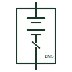

# Battery rack

A rack of series-connected battery modules with its own switchgear and battery management unit, forming one DC source.

[Canonical reference](https://eloragrid.ai/symbols/battery-rack) · [Structured record](../entries/battery-rack.json) · [All references](README.md)

Updated: 2026-10-28. Drawing use: SLD. Reference families: IEC, IEEE / ANSI, Manufacturer.

## What it represents

In stationary lithium-ion systems a battery rack holds modules connected in series to form one string, together with a rack-level switchgear box containing contactors, fuses, precharge circuit and the rack battery management unit. Racks are then paralleled onto a DC bus feeding the power conversion system.
Single-line diagrams draw each rack as a battery symbol within a boundary box that also contains the rack contactors and fuse, with the management unit shown as a small block linked by a communication line. Large systems may show one typical rack and note the number of racks in parallel.
The rack boundary on an electrical drawing does not describe mechanical arrangement, fire separation or cooling. It also does not state whether racks of different capacities can be mixed, which the battery manufacturer must confirm.

## How to read it

- One typical rack is often drawn with a multiplier note for the rest.
- Rack contactors are opened by the management system, not by the inverter.

## Drawing checklist

- State modules per rack and rack voltage.
- Show rack contactors, fuses and precharge.
- Reference number of racks in parallel.

## Important distinction

A rack is the packaged string with switchgear and management; a plain battery string symbol shows only the series cells.

## Facts

- Contents: Modules, switchgear, management unit
- Electrical role: One parallelable DC string
- Preview: Independent educational illustration; not a product outline

## Public references

- [xStorage battery energy storage system](https://www.eaton.com/us/en-us/catalog/energy-storage/xstorage-battery-energy-storage-system.html) — Eaton. Public battery energy storage cabinet context.
- [Lynx Smart BMS NG official product and documents](https://www.victronenergy.com/battery-management-systems/lynx-smart-bms-ng) — Victron Energy. Public battery management and contactor control documentation context.

## Related references

- [Battery string](battery-string.md)
- [Battery energy storage system](battery-energy-storage-system.md)
- [Battery precharge circuit](battery-precharge-circuit.md)
- [Battery storage cabinet](battery-cabinet.md)

Original educational concept geometry, CC BY 4.0. Unitless; not a certified standards glyph or manufacturer footprint.

Elora-authored explanations are CC BY 4.0. Linked standards and manufacturer material retain their own rights. Confirm project requirements using primary sources.
