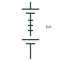

# Battery string

A series connection of cells or modules reaching the system DC voltage, often with its own fuse or breaker and monitoring.

[Canonical reference](https://eloragrid.ai/symbols/battery-string) · [Structured record](../entries/battery-string.json) · [All references](README.md)

Updated: 2026-10-28. Drawing use: SLD, Schematic. Reference families: IEC, IEEE / ANSI.

## What it represents

A battery string is a group of cells or modules connected in series to reach the operating DC voltage of an inverter, UPS or DC system. Several strings may run in parallel to increase capacity, and each string normally has its own protective device and disconnect so that one string can be isolated without shutting down the others.
Drawings show the battery symbol with the cell or module count annotated, a dashed line indicating omitted cells, and the string fuse or breaker at the positive and sometimes negative terminal. String current sensors and the battery management connections are often drawn at the same point.
The symbol does not state how strings share current or what happens when one string has a weak cell. Parallel strings of different ages or states of health share current unevenly, which the drawing alone cannot reveal.

## How to read it

- Read the annotated number of cells or modules in series.
- Each parallel string should have its own isolation and protection.

## Drawing checklist

- State cells or modules in series and nominal string voltage.
- Show string fuse or breaker and disconnect.
- Reference string current measurement.

## Important distinction

A string is one series chain; a battery bank or rack may contain several strings in parallel.

## Facts

- Connection: Series
- Protection: Per-string fuse or breaker
- Annotation: Cells or modules in series
- Preview: Independent educational illustration; consult the applicable standard and project legend for the exact graphic

## Public references

- [xStorage battery energy storage system](https://www.eaton.com/us/en-us/catalog/energy-storage/xstorage-battery-energy-storage-system.html) — Eaton. Public battery energy storage system context including string arrangements.
- [IEC graphical symbols for diagrams](https://tc3.iec.ch/tc-activity/graphical-symbols-for-diagrams/) — IEC. IEC graphical symbol context for batteries.

## Related references

- [Battery](battery.md)
- [Battery rack](battery-rack.md)
- [Single battery cell](battery-single-cell.md)
- [Battery pack current measurement](battery-current-measurement.md)

Original educational concept geometry, CC BY 4.0. Unitless; not a certified standards glyph or manufacturer footprint.

Elora-authored explanations are CC BY 4.0. Linked standards and manufacturer material retain their own rights. Confirm project requirements using primary sources.
