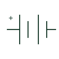

# Battery

An electrochemical electrical source or storage element represented in a circuit.

[Canonical reference](https://eloragrid.ai/symbols/battery) · [Structured record](../entries/battery.json) · [All references](README.md)

Updated: 2026-10-27. Drawing use: SLD, Schematic. Reference families: IEC, IEEE / ANSI.

## What it represents

A battery representation identifies an electrochemical source or energy-storage element. The generic depiction can suggest cells or polarity, but it does not determine the number of cells, chemistry, voltage, energy capacity or protective equipment in the selected system.
A battery energy storage system adds controls, power conversion and other equipment around its storage element. System drawings should distinguish the DC battery circuit from AC conversion, switching and protection. The physical battery cabinet is a separate GA object.

## How to read it

- Identify whether the drawing denotes a cell, battery bank or complete storage system.
- Read DC polarity and the conversion interface from the documented arrangement.

## Drawing checklist

- Reference voltage and storage equipment data.
- Separate DC storage and AC interfaces.
- Cross-reference protective and isolation equipment.

## Important distinction

A battery is a storage element. A BESS includes additional equipment and controls; the terms do not identify identical scope.

## Facts

- Electrical interface: DC
- Physical package: Model-specific
- System boundary: Distinguish battery from complete BESS

## Public references

- [Battery energy storage and power conversion](https://www.eaton.com/sg/en-us/products/energy-storage.html) — Eaton. Public explanation of storage and power conversion.
- [xStorage battery energy storage system](https://www.eaton.com/us/en-us/catalog/energy-storage/xstorage-battery-energy-storage-system.html) — Eaton. Manufacturer example of a storage-system equipment composition.

## Related references

- [Battery storage cabinet](battery-cabinet.md)
- [Power converter / inverter](power-converter.md)
- [Power conversion cabinet](pcs-cabinet.md)
- [Busbar](busbar.md)

Original educational concept geometry, CC BY 4.0. Unitless; not a certified standards glyph or manufacturer footprint.

Elora-authored explanations are CC BY 4.0. Linked standards and manufacturer material retain their own rights. Confirm project requirements using primary sources.
