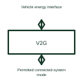

# Bidirectional EV charging interface

A bidirectional charging interface supports controlled energy transfer in both permitted directions.

[Canonical reference](https://eloragrid.ai/symbols/bidirectional-ev-charging-interface) · [Structured record](../entries/bidirectional-ev-charging-interface.json) · [All references](README.md)

Updated: 2026-10-27. Drawing use: Schematic. Reference families: Manufacturer.

## What it represents

A bidirectional charging interface supports controlled energy transfer in both permitted directions.
A compatible installation can use vehicle energy to support another electrical system under its operating arrangement.
Use arrows in both permitted energy directions and identify the controller authorising each operating mode. The vehicle, charger and connected system must support the intended exchange. Keep the energy path separate from communication and operating permission so hardware capability is not mistaken for permission to export. This is original functional artwork, not a certified standard graphic or device pinout.

## How to read it

- Identify the intended charging and export modes.
- Show the compatible vehicle and system-control interfaces.
- Reference operating permissions and the complete selected equipment.
- Bidirectional hardware does not by itself establish grid permission, compatibility or operating approval.

## Drawing checklist

- Identify the intended charging and export modes.
- Show the compatible vehicle and system-control interfaces.
- Reference operating permissions and the complete selected equipment.

## Important distinction

Bidirectional hardware does not by itself establish grid permission, compatibility or operating approval.

## Facts

- Representation type: Original functional block; not a certified IEC or IEEE graphic
- Concept input: Vehicle energy interface
- Concept output: Permitted connected-system mode

## Public references

- [DC fast charging architecture](https://www.ti.com/solution/dc-fast-charging-station) — Texas Instruments. DC fast charging architecture: public technical context for the named function. Product and compliance details remain with the publisher.

## Related references

- [DC-to-AC inverter](dc-to-ac-inverter.md)
- [DC electric vehicle charging station](dc-ev-charging-station.md)
- [EV charger power module](ev-charger-power-module.md)
- [EV charging energy measurement](ev-charging-energy-meter.md)

Original educational concept geometry, CC BY 4.0. Unitless; not a certified standards glyph or manufacturer footprint.

Elora-authored explanations are CC BY 4.0. Linked standards and manufacturer material retain their own rights. Confirm project requirements using primary sources.
