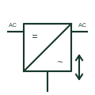

# Bidirectional inverter-charger

A battery converter that charges from an AC source and inverts back to AC, with an internal transfer relay for the load.

[Canonical reference](https://eloragrid.ai/symbols/bidirectional-inverter-charger) · [Structured record](../entries/bidirectional-inverter-charger.json) · [All references](README.md)

Updated: 2026-10-28. Drawing use: SLD, Schematic. Reference families: IEC, IEEE / ANSI, Manufacturer.

## What it represents

An inverter-charger contains one bidirectional power stage between a battery and an AC output, together with an internal transfer relay connecting the AC input to the output when a valid source is present. With the source available it passes power through and charges the battery; without it, it opens the relay and inverts from the battery.
Drawings show a converter box with DC and AC marks, a bidirectional arrow, an AC input from the grid or generator and an AC output to the load. The transfer relay may be drawn inside the boundary as a changeover contact, and some units have a second output that drops during battery operation.
The symbol does not show the internal neutral-earth relay many units use when inverting, which matters for earthing and residual current device operation. Power assist settings, which let the inverter add battery power to a limited generator supply, are also invisible on the drawing.

## How to read it

- Look for the internal transfer relay and any neutral-earth relay.
- Check whether a second output is shed on battery operation.

## Drawing checklist

- State inverter VA, charger current and battery voltage.
- Show AC input, outputs and earthing arrangement.
- Reference input current limit settings.

## Important distinction

An inverter-charger has an internal transfer relay and charger; a plain DC-to-AC inverter only converts battery power to AC.

## Facts

- Energy flow: Bidirectional
- Internal switching: AC transfer relay
- Earthing detail: Neutral-earth relay often fitted
- Preview: Independent educational illustration; consult the applicable standard and project legend for the exact graphic

## Public references

- [MultiPlus-II official product and documents](https://www.victronenergy.com/inverters-chargers/multiplus-ii) — Victron Energy. Public inverter-charger product and document page.
- [Quattro official product and documents](https://www.victronenergy.com/inverters-chargers/quattro) — Victron Energy. Public dual-input inverter-charger documentation.

## Related references

- [Hybrid inverter](hybrid-inverter.md)
- [DC-to-AC inverter](dc-to-ac-inverter.md)
- [Battery power conversion system](battery-power-conversion-system.md)
- [Battery inverter-charger](ga-battery-inverter-charger.md)

Original educational concept geometry, CC BY 4.0. Unitless; not a certified standards glyph or manufacturer footprint.

Elora-authored explanations are CC BY 4.0. Linked standards and manufacturer material retain their own rights. Confirm project requirements using primary sources.
