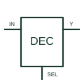

# Binary decoder / demultiplexer

Uses binary selection and enable conditions to activate the documented selected output.

[Canonical reference](https://eloragrid.ai/symbols/binary-decoder-demultiplexer) · [Structured record](../entries/binary-decoder-demultiplexer.json) · [All references](README.md)

Updated: 2026-10-27. Drawing use: Schematic. Reference families: Manufacturer.

## What it represents

Uses binary selection and enable conditions to activate the documented selected output.
On a schematic, identify the binary address inputs, enable polarities and output active level and trace the selected output channels and destination mapping. Keep the component tag and signal/reference names consistent across the control drawing, terminal schedule and device documentation.
A decoder and a demultiplexer can share a device implementation; this record combines those uses rather than counting the same hardware twice.
The preview is an independently drawn educational functional reference. Add the selected component’s actual power pins, terminal numbers, timing or analogue reference details when producing a construction drawing.

## How to read it

- Identify the binary address inputs, enable polarities and output active level.
- Trace the selected output channels and destination mapping.

## Drawing checklist

- Label the binary address inputs, enable polarities and output active level.
- Cross-reference the selected output channels and destination mapping.
- Add the selected device or circuit documentation revision, power/reference connections and project signal convention.

## Important distinction

A decoder and a demultiplexer can share a device implementation; this record combines those uses rather than counting the same hardware twice.

## Facts

- Common schematic mnemonic: DEC — descriptive only; project/device documentation defines reference designations.
- Terminal / interface focus: The binary address inputs, enable polarities and output active level
- Artwork scope: Original educational functional/circuit reference; not a selected product pinout.

## Public references

- [SN74HC138 — binary decoding and demultiplexing](https://www.ti.com/lit/ds/symlink/sn74hc138.pdf) — Texas Instruments. Public primary manufacturer documentation establishes the component function or circuit/topology relationship. Preview geometry and drafting explanations are independently authored.

## Related references

- [Digital multiplexer](digital-multiplexer.md)
- [PLC input / output](plc-io.md)

Original educational concept geometry, CC BY 4.0. Unitless; not a certified standards glyph or manufacturer footprint.

Elora-authored explanations are CC BY 4.0. Linked standards and manufacturer material retain their own rights. Confirm project requirements using primary sources.
