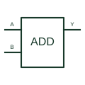

# Binary full adder

Adds binary input words with the documented carry-in and produces sum and carry outputs.

[Canonical reference](https://eloragrid.ai/symbols/binary-full-adder) · [Structured record](../entries/binary-full-adder.json) · [All references](README.md)

Updated: 2026-10-27. Drawing use: Schematic. Reference families: Manufacturer.

## What it represents

Adds binary input words with the documented carry-in and produces sum and carry outputs.
On a schematic, identify the input word buses, bit order and carry-in and trace the sum word and carry-out/cascade connection. Keep the component tag and signal/reference names consistent across the control drawing, terminal schedule and device documentation.
A full adder performs arithmetic; an OR gate cannot replace its sum/carry relationships.
The preview is an independently drawn educational functional reference. Add the selected component’s actual power pins, terminal numbers, timing or analogue reference details when producing a construction drawing.

## How to read it

- Identify the input word buses, bit order and carry-in.
- Trace the sum word and carry-out/cascade connection.

## Drawing checklist

- Label the input word buses, bit order and carry-in.
- Cross-reference the sum word and carry-out/cascade connection.
- Add the selected device or circuit documentation revision, power/reference connections and project signal convention.

## Important distinction

A full adder performs arithmetic; an OR gate cannot replace its sum/carry relationships.

## Facts

- Common schematic mnemonic: ADD — descriptive only; project/device documentation defines reference designations.
- Terminal / interface focus: The input word buses, bit order and carry-in
- Artwork scope: Original educational functional/circuit reference; not a selected product pinout.

## Public references

- [CD74HC283 — binary full adders](https://www.ti.com/product/CD74HC283) — Texas Instruments. Public primary manufacturer documentation establishes the component function or circuit/topology relationship. Preview geometry and drafting explanations are independently authored.

## Related references

- [Exclusive-OR gate](logic-xor-gate.md)
- [PLC input / output](plc-io.md)

Original educational concept geometry, CC BY 4.0. Unitless; not a certified standards glyph or manufacturer footprint.

Elora-authored explanations are CC BY 4.0. Linked standards and manufacturer material retain their own rights. Confirm project requirements using primary sources.
