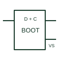

# Bootstrap gate-drive supply

A diode-capacitor arrangement used to supply a floating high-side gate-driver circuit under documented switching conditions.

[Canonical reference](https://eloragrid.ai/symbols/bootstrap-gate-supply) · [Structured record](../entries/bootstrap-gate-supply.json) · [All references](README.md)

Updated: 2026-10-27. Drawing use: Schematic. Reference families: Manufacturer.

## What it represents

A diode-capacitor arrangement used to supply a floating high-side gate-driver circuit under documented switching conditions.
On a schematic, identify the bootstrap diode, capacitor and switching-node return and trace the driver's floating supply and charging path. Keep the component tag and signal/reference names consistent across the control drawing, terminal schedule and device documentation.
A bootstrap circuit depends on its charging opportunity; it is not a continuous independent isolated DC supply.
The preview is an independently drawn educational functional reference. Add the selected component’s actual power pins, terminal numbers, timing or analogue reference details when producing a construction drawing.

## How to read it

- Identify the bootstrap diode, capacitor and switching-node return.
- Trace the driver's floating supply and charging path.

## Drawing checklist

- Label the bootstrap diode, capacitor and switching-node return.
- Cross-reference the driver's floating supply and charging path.
- Add the selected device or circuit documentation revision, power/reference connections and project signal convention.

## Important distinction

A bootstrap circuit depends on its charging opportunity; it is not a continuous independent isolated DC supply.

## Facts

- Common schematic mnemonic: BOOT — descriptive only; project/device documentation defines reference designations.
- Terminal / interface focus: The bootstrap diode, capacitor and switching-node return
- Artwork scope: Original educational functional/circuit reference; not a selected product pinout.

## Public references

- [UCC27714 — high-side and low-side gate drive with bootstrap context](https://www.ti.com/product/UCC27714) — Texas Instruments. Public primary manufacturer documentation establishes the component function or circuit/topology relationship. Preview geometry and drafting explanations are independently authored.

## Related references

- [High-side gate driver](high-side-gate-driver.md)
- [Diode](diode.md)

Original educational concept geometry, CC BY 4.0. Unitless; not a certified standards glyph or manufacturer footprint.

Elora-authored explanations are CC BY 4.0. Linked standards and manufacturer material retain their own rights. Confirm project requirements using primary sources.
