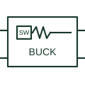

# Buck converter topology

A switching converter arrangement used to produce a lower DC output from its input under the documented operating conditions.

[Canonical reference](https://eloragrid.ai/symbols/buck-converter-topology) · [Structured record](../entries/buck-converter-topology.json) · [All references](README.md)

Updated: 2026-10-27. Drawing use: Schematic, SLD. Reference families: Manufacturer.

## What it represents

A switching converter arrangement used to produce a lower DC output from its input under the documented operating conditions.
On a schematic, identify the input supply, switching node, energy-storage inductor and return and trace the regulated output, feedback path and freewheeling arrangement. Keep the component tag and signal/reference names consistent across the control drawing, terminal schedule and device documentation.
Buck identifies a conversion topology; its schematic does not by itself define an isolated supply or an allowed operating range.
The preview is a conceptual topology reference rather than a complete power-stage circuit. Switching sequences, magnetic design, component selection and control/protection details belong in the equipment design documentation.

## How to read it

- Identify the input supply, switching node, energy-storage inductor and return.
- Trace the regulated output, feedback path and freewheeling arrangement.

## Drawing checklist

- Label the input supply, switching node, energy-storage inductor and return.
- Cross-reference the regulated output, feedback path and freewheeling arrangement.
- Add the selected device or circuit documentation revision, power/reference connections and project signal convention.

## Important distinction

Buck identifies a conversion topology; its schematic does not by itself define an isolated supply or an allowed operating range.

## Facts

- Common schematic mnemonic: BUCK — descriptive only; project/device documentation defines reference designations.
- Terminal / interface focus: The input supply, switching node, energy-storage inductor and return
- Artwork scope: Original conceptual topology block; not a complete switch-level circuit.

## Public references

- [Power topology selection and public topology tutorials](https://www.ti.com/video/series/power-topology-selection.html) — Texas Instruments. Public primary manufacturer documentation establishes the component function or circuit/topology relationship. Preview geometry and drafting explanations are independently authored.

## Related references

- [Boost converter topology](boost-converter-topology.md)
- [Power converter / inverter](power-converter.md)

Original educational concept geometry, CC BY 4.0. Unitless; not a certified standards glyph or manufacturer footprint.

Elora-authored explanations are CC BY 4.0. Linked standards and manufacturer material retain their own rights. Confirm project requirements using primary sources.
