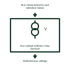

# Bus-voltage selection relay interface

Selects the voltage measurement associated with the bus supplying the protected circuit.

[Canonical reference](https://eloragrid.ai/symbols/bus-voltage-selection-relay-interface) · [Structured record](../entries/bus-voltage-selection-relay-interface.json) · [All references](README.md)

Updated: 2026-11-03. Drawing use: Schematic. Reference families: Manufacturer.

Representation: functional-block; installation focus: substations.
Bus measurements and selection status
Selected bus voltage

## What it represents

Selects the voltage measurement associated with the bus supplying the protected circuit. A voltage-transformer secondary arrangement connects a defined primary voltage measurement to protection, metering or control inputs. Winding identity, fuse protection and the voltage reference must remain visible across the drawing.
In a substation bay, one voltage circuit can feed protection while a separately identified winding supplies metering. A voltage-selection circuit must make clear which bus or line measurement is being used. For this reference, the drawing identifies “Bus measurements and selection status” at the input and “Selected bus voltage” at the output. Selection must follow the actual bus configuration.
Show the primary measurement point, secondary connection, protective devices and relay reference. A missing measurement can resemble a real system disturbance unless the voltage-circuit health is supervised appropriately. The functional block is an independent explanation of this named application. Equipment-specific ratings, terminal connections and operating conditions must be established in the project documentation.

## How to read it

- Start at the named input: Bus measurements and selection status. Identify its source device or document and the state represented on the drawing.
- Follow the named output: Selected bus voltage. Cross-reference its destination and separate the command from confirmation that the equipment responded.
- Selection must follow the actual bus configuration.
- Show the primary measurement point, secondary connection, protective devices and relay reference. A missing measurement can resemble a real system disturbance unless the voltage-circuit health is supervised appropriately.

## Drawing checklist

- Label the source and connection reference for bus measurements and selection status.
- Identify the destination and defined state of selected bus voltage.
- Record the equipment or control-document revision supporting this functional block.
- Check this application limit in the project design: Selection must follow the actual bus configuration.

## Important distinction

Selection must follow the actual bus configuration. This reference describes the named application; it does not establish a new IEC graphical symbol, an ANSI device-function number or an exact manufacturer connection diagram.

## Facts

- Representation: Functional block
- Installation focus: Substations
- Input / boundary: Bus measurements and selection status
- Output / connection: Selected bus voltage
- Lookup label: BSRI is a library lookup label, not a standard device designation.

## Public references

- [Indoor current and voltage transformers](https://www.abb.com/gb/en/areas/electrification/medium-voltage/grid-components/core-components/indoor-instrument-transformers) — ABB. Public technical context for voltage-transformer secondary arrangements. Current and voltage measurement transformers and their secondary interfaces. The application text and educational graphic are independently authored; the publisher does not certify this representation.

## Related references

- [Voltage transformer](voltage-transformer.md)
- [Potential test switch](potential-test-switch.md)
- [Line-voltage synchronising input interface](line-voltage-synchronising-input-interface.md)

Original educational concept geometry, CC BY 4.0. Unitless; not a certified standards glyph or manufacturer footprint.

Elora-authored explanations are CC BY 4.0. Linked standards and manufacturer material retain their own rights. Confirm project requirements using primary sources.
