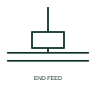

# Busway end feed unit

The point where incoming cables or a transformer connect to the end of a busway run, drawn as a feed box on the busway.

[Canonical reference](https://eloragrid.ai/symbols/busway-end-feed-unit) · [Structured record](../entries/busway-end-feed-unit.json) · [All references](README.md)

Updated: 2026-10-28. Drawing use: SLD, GA. Reference families: IEC, IEEE / ANSI, Manufacturer.

## What it represents

An end feed unit is the cable or transformer connection box at the start of a busway run. On single-line diagrams it shows where the supply enters the busway and is often annotated with the incoming cable details. Centre feed units, used to reduce voltage drop on long runs, are a related variant.
The symbol does not show whether the feed unit includes isolation. Many end feed units are simple cable boxes, so isolation for maintenance must be at the upstream switchboard. Check cable entry and gland plate sizes on the layout, because large parallel cable sets need substantial space.

## How to read it

- Confirm where isolation for the busway is provided.
- Read incoming cable data at the feed unit.

## Drawing checklist

- Show the incoming cable or transformer connection.
- Identify upstream isolation.
- Reference the feed unit size and cable entry.

## Important distinction

An end feed unit brings supply into the busway; a tap-off connection takes supply out of it.

## Facts

- Graphic cue: Box at the end of a busway with incoming conductors
- Variant: Centre feed units exist for long runs
- Preview: Original educational illustration; consult the publisher and applicable standard for the exact graphic

## Public references

- [Canalis busbar trunking systems](https://www.se.com/ww/en/work/products/master-ranges/line-series/) — Schneider Electric. Manufacturer busbar trunking ranges including feed units.
- [IEC-60617 symbol preview directory](https://help.autodesk.com/cloudhelp/2021/ENU/AutoCAD-Electrical/files/GUID-7871E6EF-24D5-467E-9B74-321FEDC9DFDA.htm) — Autodesk. Public directory of IEC-oriented symbol families.

## Related references

- [Feeder busway](busway-feeder-run.md)
- [Plug-in busway](plug-in-busway.md)
- [Busbar trunking](busbar-trunking.md)

Original educational concept geometry, CC BY 4.0. Unitless; not a certified standards glyph or manufacturer footprint.

Elora-authored explanations are CC BY 4.0. Linked standards and manufacturer material retain their own rights. Confirm project requirements using primary sources.
