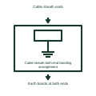

# Cable sheath both-end bonding arrangement

Shows the assigned earth bonds at both ends of the documented cable sheath circuit.

[Canonical reference](https://eloragrid.ai/symbols/cable-sheath-both-end-bonding-arrangement) · [Structured record](../entries/cable-sheath-both-end-bonding-arrangement.json) · [All references](README.md)

Updated: 2026-11-03. Drawing use: Schematic. Reference families: Manufacturer.

Representation: functional-block; installation focus: switchyards.
Cable sheath ends
Earth bonds at both ends

## What it represents

Shows the assigned earth bonds at both ends of the documented cable sheath circuit. Earthing and lightning interfaces identify the connections between equipment metalwork, primary protection devices and the station earthing network. Their electrical purpose differs from their physical conductor route or electrode geometry.
In a switchyard arrangement, the earthing references help connect each primary equipment structure and surge-protection device to the correct earth-grid interface. Separate details show actual joints, sizes and installation routes. For this reference, the drawing identifies “Cable sheath ends” at the input and “Earth bonds at both ends” at the output. Circulating sheath currents require assessment.
Name every connected item and the earthing design reference. The illustrative connection does not establish touch or step voltages, conductor sizing, lightning coverage or safe working conditions. The functional block is an independent explanation of this named application. Equipment-specific ratings, terminal connections and operating conditions must be established in the project documentation.

## How to read it

- Start at the named input: Cable sheath ends. Identify its source device or document and the state represented on the drawing.
- Follow the named output: Earth bonds at both ends. Cross-reference its destination and separate the command from confirmation that the equipment responded.
- Circulating sheath currents require assessment.
- Name every connected item and the earthing design reference. The illustrative connection does not establish touch or step voltages, conductor sizing, lightning coverage or safe working conditions.

## Drawing checklist

- Label the source and connection reference for cable sheath ends.
- Identify the destination and defined state of earth bonds at both ends.
- Record the equipment or control-document revision supporting this functional block.
- Check this application limit in the project design: Circulating sheath currents require assessment.

## Important distinction

Circulating sheath currents require assessment. This reference describes the named application; it does not establish a new IEC graphical symbol, an ANSI device-function number or an exact manufacturer connection diagram.

## Facts

- Representation: Functional block
- Installation focus: Switchyards
- Input / boundary: Cable sheath ends
- Output / connection: Earth bonds at both ends
- Lookup label: CSBBA is a library lookup label, not a standard device designation.

## Public references

- [Earthing connections](https://www.electrical-installation.org/enwiki/Earthing_connections) — Schneider Electric, Electrical Installation Guide. Public technical context for switchyard earthing and lightning interfaces. Protective earthing, bonding and earth-electrode interfaces. The application text and educational graphic are independently authored; the publisher does not certify this representation.

## Related references

- [Earth electrode](iec-earth-electrode.md)
- [Lightning protection down-conductor](lightning-down-conductor.md)
- [Cable sheath cross-bonding section interface](cable-sheath-cross-bonding-section-interface.md)

Original educational concept geometry, CC BY 4.0. Unitless; not a certified standards glyph or manufacturer footprint.

Elora-authored explanations are CC BY 4.0. Linked standards and manufacturer material retain their own rights. Confirm project requirements using primary sources.
