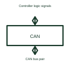

# CAN bus transceiver

CAN (Controller Area Network) lets electronic devices exchange messages. A transceiver is the part that sends and receives the network's electrical signals.

[Canonical reference](https://eloragrid.ai/symbols/can-bus-transceiver) · [Structured record](../entries/can-bus-transceiver.json) · [All references](README.md)

Updated: 2026-10-27. Drawing use: Schematic. Reference families: Manufacturer.

## What it represents

CAN (Controller Area Network) lets electronic devices exchange messages. A transceiver is the part that sends and receives the network's electrical signals.
For example, a battery controller can report measurements to a system controller over a compatible CAN connection.
Put the CAN controller on the logic side and the CAN bus pair on the other side of the transceiver. The controller creates and interprets messages; the transceiver drives and receives their electrical signals. Show bus termination and reference connections from the selected network design. This is original functional artwork, not a certified standard graphic or device pinout.

## How to read it

- Separate controller transmit/receive signals from bus conductors.
- Reference the selected termination and cable arrangement.
- Identify the transceiver supply and bus-reference connections.
- The transceiver supplies a physical interface; it is not necessarily the CAN protocol controller.

## Drawing checklist

- Separate controller transmit/receive signals from bus conductors.
- Reference the selected termination and cable arrangement.
- Identify the transceiver supply and bus-reference connections.

## Important distinction

The transceiver supplies a physical interface; it is not necessarily the CAN protocol controller.

## Facts

- Representation type: Original functional block; not a certified IEC or IEEE graphic
- Concept input: Controller logic signals
- Concept output: CAN bus pair

## Public references

- [CAN interface functions](https://www.ti.com/product-category/interface/can-transceivers/overview.html) — Texas Instruments. CAN interface functions: public technical context for the named function. Product and compliance details remain with the publisher.

## Related references

- [Logic bus transceiver](logic-bus-transceiver.md)
- [CAN FD transceiver](can-fd-transceiver.md)
- [Power converter / inverter](power-converter.md)
- [Terminal connection](terminal.md)

Original educational concept geometry, CC BY 4.0. Unitless; not a certified standards glyph or manufacturer footprint.

Elora-authored explanations are CC BY 4.0. Linked standards and manufacturer material retain their own rights. Confirm project requirements using primary sources.
