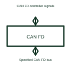

# CAN FD transceiver

CAN FD means CAN with Flexible Data Rate. Its transceiver sends and receives the electrical signals used by that compatible network.

[Canonical reference](https://eloragrid.ai/symbols/can-fd-transceiver) · [Structured record](../entries/can-fd-transceiver.json) · [All references](README.md)

Updated: 2026-10-27. Drawing use: Schematic. Reference families: Manufacturer.

## What it represents

CAN FD means CAN with Flexible Data Rate. Its transceiver sends and receives the electrical signals used by that compatible network.
A node can connect a CAN FD controller to the selected physical network.
Show the same distinction between controller-side logic and bus-side signalling as for CAN, then identify the required CAN FD capability. Flexible Data Rate changes the supported communication requirements; it is not a promise that every existing node or cable arrangement supports the intended operating conditions. This is original functional artwork, not a certified standard graphic or device pinout.

## How to read it

- Identify controller and transceiver CAN FD capability.
- Reference the selected bus timing and termination design.
- Record compatibility requirements for every connected node.
- A CAN FD transceiver alone does not establish the timing, cable layout or capability of every network node.

## Drawing checklist

- Identify controller and transceiver CAN FD capability.
- Reference the selected bus timing and termination design.
- Record compatibility requirements for every connected node.

## Important distinction

A CAN FD transceiver alone does not establish the timing, cable layout or capability of every network node.

## Facts

- Representation type: Original functional block; not a certified IEC or IEEE graphic
- Concept input: CAN FD controller signals
- Concept output: Specified CAN FD bus

## Public references

- [CAN interface functions](https://www.ti.com/product-category/interface/can-transceivers/overview.html) — Texas Instruments. CAN interface functions: public technical context for the named function. Product and compliance details remain with the publisher.

## Related references

- [Logic bus transceiver](logic-bus-transceiver.md)
- [CAN bus transceiver](can-bus-transceiver.md)
- [Power converter / inverter](power-converter.md)
- [Terminal connection](terminal.md)

Original educational concept geometry, CC BY 4.0. Unitless; not a certified standards glyph or manufacturer footprint.

Elora-authored explanations are CC BY 4.0. Linked standards and manufacturer material retain their own rights. Confirm project requirements using primary sources.
