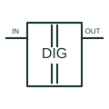

# Capacitive digital isolator

Transfers digital information between separately referenced electrical domains through a capacitive isolation structure.

[Canonical reference](https://eloragrid.ai/symbols/capacitive-digital-isolator) · [Structured record](../entries/capacitive-digital-isolator.json) · [All references](README.md)

Updated: 2026-10-27. Drawing use: Schematic. Reference families: Manufacturer.

## What it represents

Transfers digital information between separately referenced electrical domains through a capacitive isolation structure.
On a schematic, identify the two domain supplies, channel directions and isolation boundary and trace the isolated data, enable and fault/status paths. Keep the component tag and signal/reference names consistent across the control drawing, terminal schedule and device documentation.
A digital isolator transfers logic; it does not by itself provide an isolated power supply.
The preview is an independently drawn educational functional reference. Add the selected component’s actual power pins, terminal numbers, timing or analogue reference details when producing a construction drawing.

## How to read it

- Identify the two domain supplies, channel directions and isolation boundary.
- Trace the isolated data, enable and fault/status paths.

## Drawing checklist

- Label the two domain supplies, channel directions and isolation boundary.
- Cross-reference the isolated data, enable and fault/status paths.
- Add the selected device or circuit documentation revision, power/reference connections and project signal convention.

## Important distinction

A digital isolator transfers logic; it does not by itself provide an isolated power supply.

## Facts

- Common schematic mnemonic: DIG-ISO — descriptive only; project/device documentation defines reference designations.
- Terminal / interface focus: The two domain supplies, channel directions and isolation boundary
- Artwork scope: Original educational functional/circuit reference; not a selected product pinout.

## Public references

- [ISO7741 — capacitive digital isolation](https://www.ti.com/product/ISO7741) — Texas Instruments. Public primary manufacturer documentation establishes the component function or circuit/topology relationship. Preview geometry and drafting explanations are independently authored.

## Related references

- [PLC digital input](plc-digital-input.md)
- [Diode](diode.md)

Original educational concept geometry, CC BY 4.0. Unitless; not a certified standards glyph or manufacturer footprint.

Elora-authored explanations are CC BY 4.0. Linked standards and manufacturer material retain their own rights. Confirm project requirements using primary sources.
