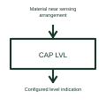

# Capacitive level sensor

A capacitive level sensor uses a change in capacitance associated with material near its sensing arrangement.

[Canonical reference](https://eloragrid.ai/symbols/capacitive-level-sensor) · [Structured record](../entries/capacitive-level-sensor.json) · [All references](README.md)

Updated: 2026-10-27. Drawing use: Schematic. Reference families: Manufacturer.

## What it represents

A capacitive level sensor uses a change in capacitance associated with material near its sensing arrangement.
A tank-level system can detect a changing material level using a suitable sensor and calibration.
Show the sensing electrode or arrangement, surrounding material and relevant vessel reference. A change in capacitance is interpreted using the selected installation and calibration. The material’s electrical properties matter, so a layout should identify the actual contents rather than treating all liquids or solids as equivalent. This is original functional artwork, not a certified standard graphic or device pinout.

## How to read it

- Identify sensing arrangement and vessel reference.
- State the material and required level indication.
- Reference calibration, mounting and output requirements.
- Material properties and vessel geometry affect the response and must be part of the selected design.

## Drawing checklist

- Identify sensing arrangement and vessel reference.
- State the material and required level indication.
- Reference calibration, mounting and output requirements.

## Important distinction

Material properties and vessel geometry affect the response and must be part of the selected design.

## Facts

- Representation type: Original functional block; not a certified IEC or IEEE graphic
- Concept input: Material near sensing arrangement
- Concept output: Configured level indication

## Public references

- [Capacitive liquid-level reference design](https://www.ti.com/tool/TIDA-00317) — Texas Instruments. Primary-source technical context for this particular function; product-specific ratings remain with the manufacturer.

## Related references

- [Temperature measuring transducer](temperature-measuring-transducer.md)
- [Hall-effect current sensor](hall-effect-current-sensor.md)
- [Magnetic position sensor](magnetic-position-sensor.md)
- [Inductive position sensor](inductive-position-sensor.md)

Original educational concept geometry, CC BY 4.0. Unitless; not a certified standards glyph or manufacturer footprint.

Elora-authored explanations are CC BY 4.0. Linked standards and manufacturer material retain their own rights. Confirm project requirements using primary sources.
